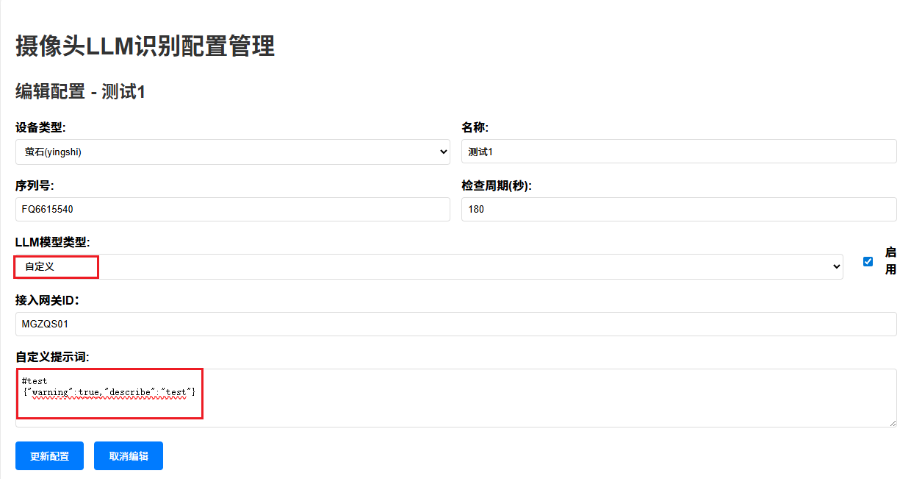
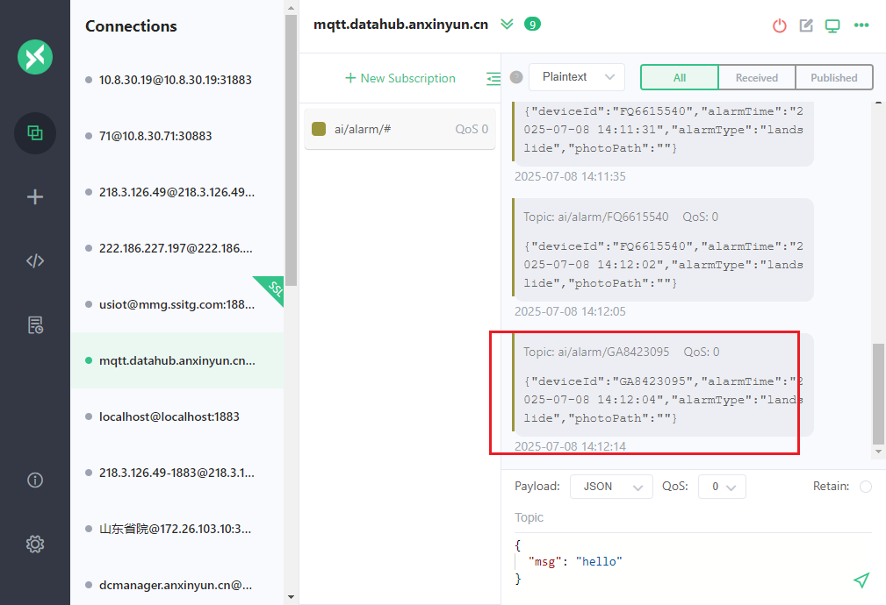
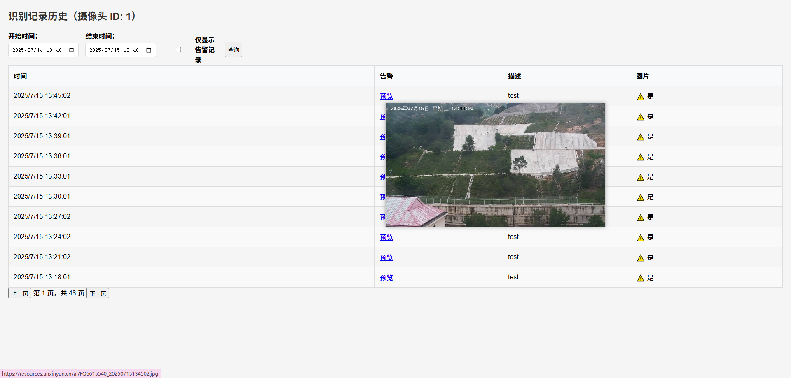

### AI摄像头抓拍功能自测报告

在线识别程序，部署在安心云集群iot命名空间下

https://ksboard.ngaiot.com/cloud-workspace/clusters/default/projects/iot/deployments/video-recognition/resource-status

访问地址：

http://xxxxx:32145/


配置地址：https://ksboard.ngaiot.com/cloud-workspace/clusters/default/projects/iot/configmaps/cm-video-recognition/detail

配置数据库地址、AI地址和key，mqtt发布地址、以及七牛相关参数，如下：


### 自测：

目前环境（http://xxxxx:32145/）中已接入现场50+摄像头。

但是现在不一定存在灾害，配置测试条件可模拟生成（按照如下截图配置）,生成灾害告警。

另外，部分摄像头场景目前存在告警（比如参见：http://xxxxxx:32145/camera-llm/history/37）



> 选择LLM模型类型为“自定义”，提示词处输入：
>
> #test
> {"warning":true,"describe":"test"}


监听MQTT服务器（mqtt.datahub.anxinyun.cn）

 订阅TOPIC：（ai/recognize/#），收到识别事件消息

```json
{"deviceId":"GA8423147","alarmTime":1752558062,"alarmType":"none","photoPath":"https://221.230.55.29:10443/ngx/proxy?i=aHR0cHM6Ly8xMC44LjMwLjE3Mzo2MTEzL3BpYz85ZDAwPWU2MDJsZDQtZG81NDE4KjgxMDgxMDk5LTJkY2M1OGZiNSo1ZThzPSoqOTE3PT10cCo3MTE0PTk1NjIwOTcqMDA5MD02bDJvMyo0MjQtPTkzM2YyNnBpMTAybz0wLTY4MDBiMCZBY2Nlc3NLZXlJZD1lOGhYSW5WenRJRFVXS2pzJkV4cGlyZXM9MTc1MjY0NDU1NSZTaWduYXR1cmU9MDdaWVRZdHR3UEhxMUFXMlo3TkJ6ckMzbzNnPQ==","photoData":"/9j/4AAQSkZJ....hvnQR5zyMc898mi4z/2Q==","alarmMsg":"","detailMsg":"","confidence":100,"level":1,"location":{"lat":0,"lon":0}}

```

> "alarmType":"none"表示本次未识别到告警。
>
> “photoData”中是本次抓拍的图片BASE64数据。


 订阅TOPIC：（ai/alarm/#）收到灾害告警消息（如下）





可以查看历史识别记录：

