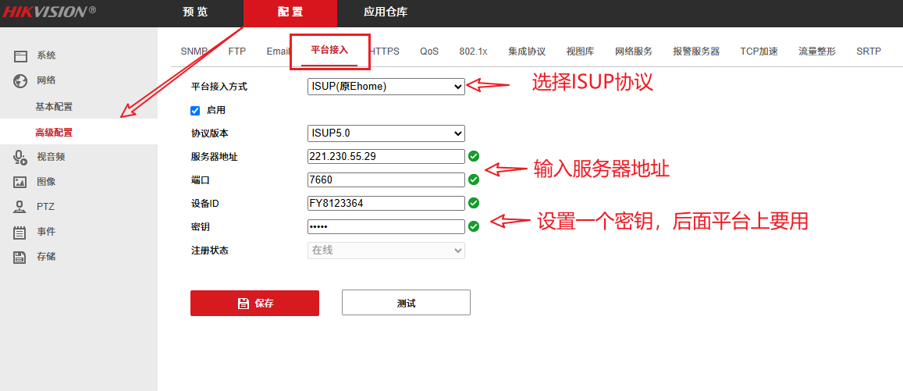
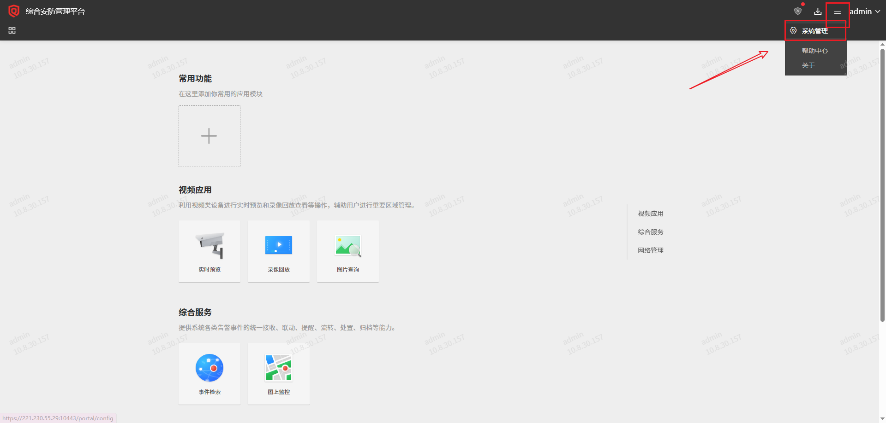
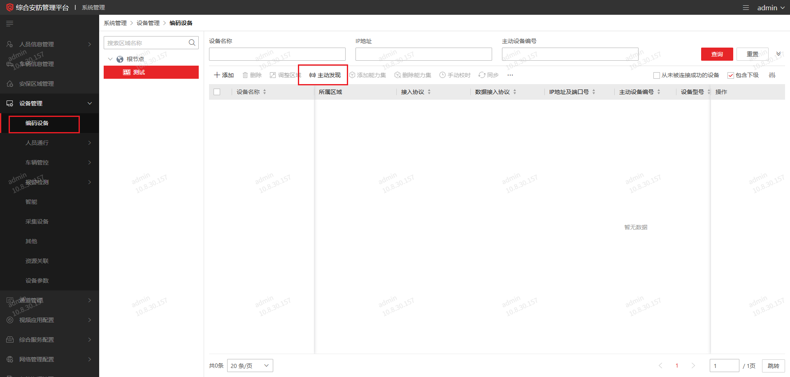
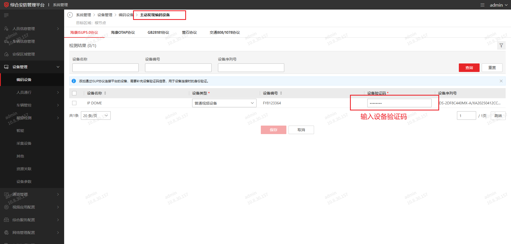
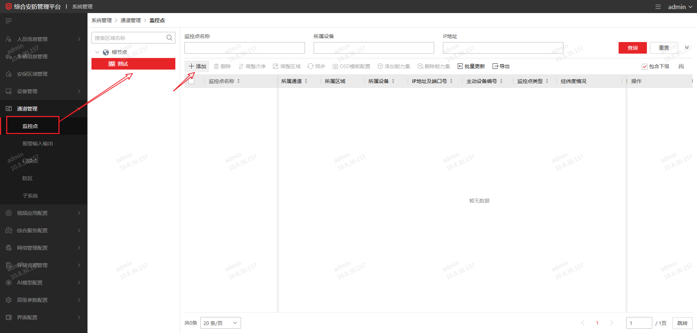
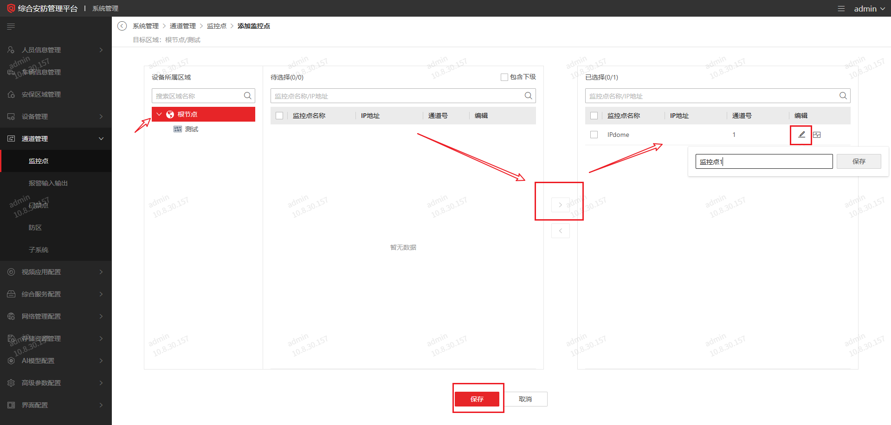
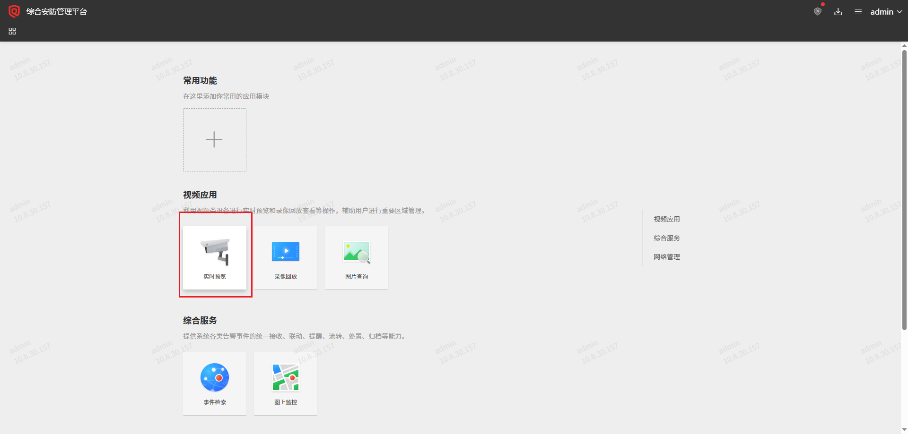
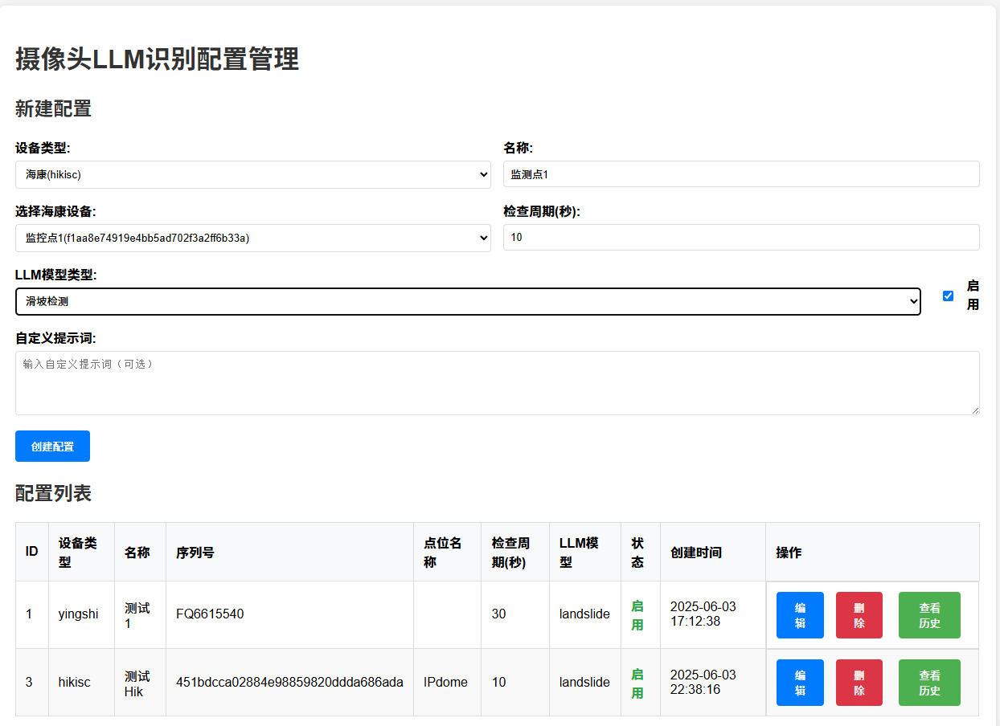
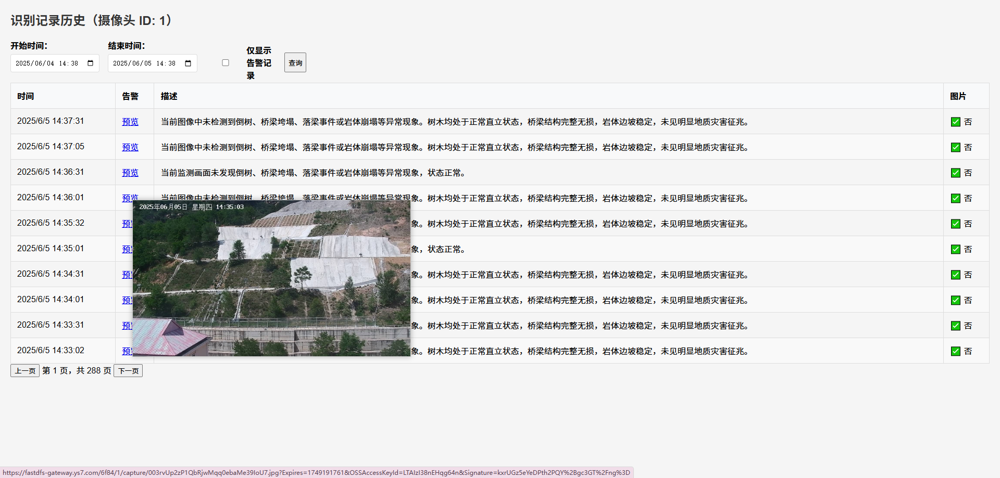

### AI摄像头接入配置方法

#### 1、摄像头配置

通过网线将摄像头与电脑相连，在浏览器中打开摄像头管理界面，默认 http://192.168.1.64/

进入配置，网络配置：

服务器地址：221.230.55.29

端口：7660 或者 7031

#### 2、海康ISC平台中添加

登录海康ISC平台  https://221.230.55.29:10443/portal/  登录账户admin / `F****5_`

进入后台【系统管理】界面

进入【设备管理】-【编码设备】

勾选后，点击【保存】。

再添加【监控点】

> 注意：测点可以命名，这里建议重命名为实际位置信息，便于区分。

监控点添加完成后，可以到【预览界面】看看摄像头视频能不能正常播放：

#### 3、模型识别配置

登录模型配置网站：http://222.186.227.196:32145/

选择设备类型：【海康(hikisc)】，输入识别【名称】。 选择【海康设备】并配置检查周期。 LLM模型处选择【滑坡检测】。点击【创建配置即可】

可以查看历史识别的记录：

