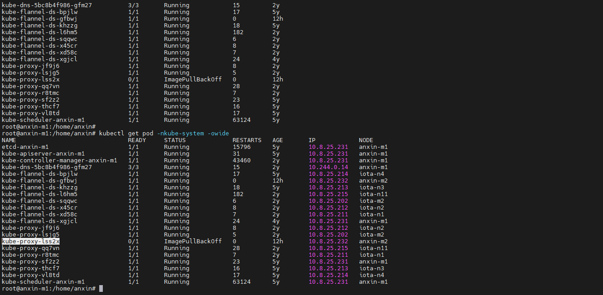
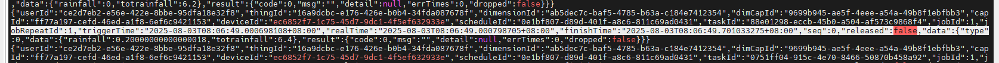
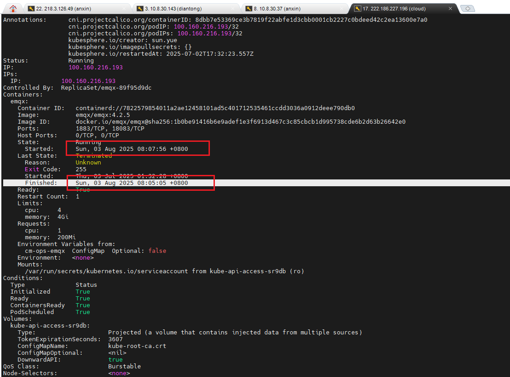

# DAC 数据采集服务问题总结与分析

DAC 作为平台数据采集服务，目前存在较多问题以及稳定性波动，采集数据丢失已成为共性且系统性问题。以下为近半年问题情况的梳理和总结。

---

## 一、问题汇总

1. **在线状态显示错误**
2. **协议导致内存泄漏**（已增加保护）
3. **假连接问题**（设备连接 Proxy，但 DAC 未接入）
4. **维度丢失**（如黑崖沟振动数据）
5. **DAC-15 不启动问题**（编排器相关）
6. **程序启动慢**  
   - 重启需 10~15 分钟  
   - 启动过程中设备上报会出现 "No Data handler"
7. **Kafka 环境问题**（需重启维护）
8. **iota-m2 服务器稳定性差**（需重启维护）
9. **人工手动重启**（如升级或其他维护操作）

---

## 二、问题难点分析

1. **排查周期长**  
   - 需查验数据连续性、Kafka 消息、协议日志、后续数据处理进程日志等
2. **本地复现困难**  
   - 无本地完整分布式环境，问题需 proxy + DAC + 编排器联合运行才能复现
3. **遗留问题复杂**  
   - 代码逻辑复杂或存在架构性缺陷
4. **运行环境不稳定**  
   - 硬件问题、缺乏长期跟踪与运维人员

---

## 三、已有解决或临时方案

| 问题             | 当前处理方式                                       |
| ---------------- | -------------------------------------------------- |
| 在线状态显示错误 | 已定位问题，但涉及主逻辑较多，改动引发新问题已回退 |
| 协议内存泄漏     | 增加协议资源限制和 K8s pod 限制，避免资源耗尽      |
| 假连接问题       | DAC-Plugin 监控，断连后自动重启                    |
| 维度丢失         | DAC-Plugin 监控，未启动维度自动重启                |

---

## 四、后续解决思路

1. **增加保护机制**  
   - 协议防护、内存管理、Panic处理机制
2. **加强监控体系**  
   - 每个 DAC 实例绑定【模拟数据源】，监控数据连续性，排除设备因素
3. **深入研究关键代码**  
   - 指定专人研究 DAC 内部组件、编排器（Node.js）、代理转发（iota-proxy）等
4. **优化运行环境**  
   - 搭建完整开发测试环境，扩充以太集群服务器，升级 Kafka 节点

---

## 五、后续计划

- **8 月 5 日**：组织专题问题会议  
  - 明确问题归属  
  - 细化责任人  
  - 制定解决时间表


### 补充:

#### 问题1. DAC容器中无法请求redis

观察到系统日志有OOM的情况。

anxin-m2上主要有多个DAC实例，怀疑某个DAC导致环境异常。

云振动、GNSS等数据未恢复，是因为协议脚本中REDIS连接不上。

查看系统pod才发现是kube-proxy网络代理失败，导致容器内网络不通（怀疑是anxin-m2服务器异常导致，且该系统组件未自动恢复 - 因为对应的镜像文件丢失，需手动拉取）



恢复Kube-proxy之后，相关依赖REDIS的采集恢复了。

**总结**：

内存溢出导致的服务器异常，波及k8s系统组件，导致程式异常。


#### 问题2. ET存储失效

ET日志中只有以下日志内容：

```txt

actor 发送 capId= xxx xxxx
```

没有任何计算分组日志、存储日志。

部分实例失效，导致未能检测到”超过xx结构物数据中断“

怀疑是部分ET实例中：

1. ACTOR失效
2. 存储阻塞导致

解决办法：

	+ 重启ET
	+ 单个ET实例监控（TODO）


#### 问题3. 雨量数据丢失3个粒度

雨量数据丢失3个粒度：

安心云kafka中无数据

以太kafka中有数据



查看规则引擎

> 有重启，但是不在该时间段

查看安心云EMQX （时间匹配）

