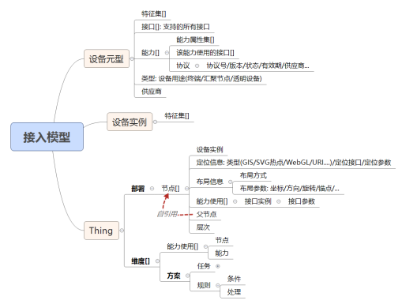
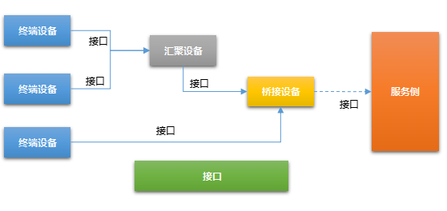
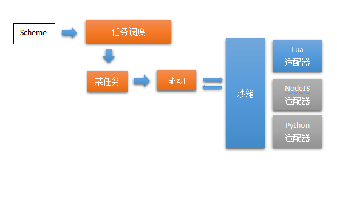
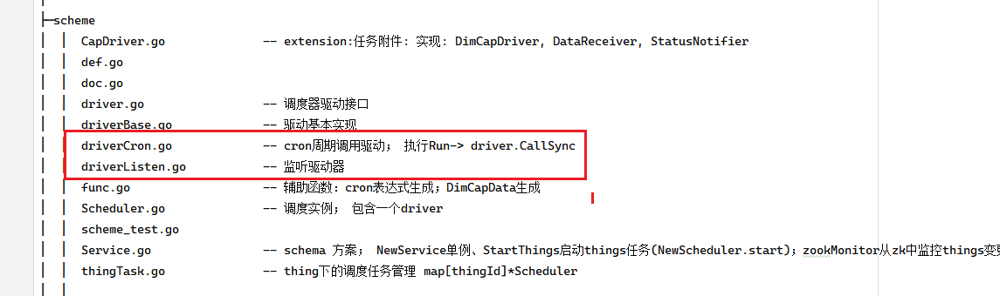
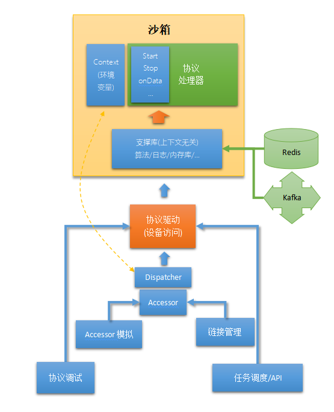

## DAC相关知识分享

> 物联网平台的核心组件，负责设备通信和数据采集。


#### :cloud: 环境部署


这里几个进程的命名：

| 名称         | 说明                                                    |      |
| ------------ | ------------------------------------------------------- | ---- |
| DAC          | **D**ata **A**cquisition **C**ontroller  本次分享的主角 |      |
| Proxy        | 接入网关代理。                                          |      |
| orchestrator | 多实例控制、编排管理                                    |      |

> 还有一些外部服务，保证程序间可以正确的协同工作。包括消息总线有KAFKA、MQTT，资源调度 ZOOKEEPER以及监控PROMETHEUS等


#### ☕ 基本概念

- **DeviceMeta**: 设备概式（DNA）
- **Device**: 设备实例（实际装备）
- **Thing**: 监测对象（形成我们的物联网世界）
- **Layout**: 部署与网络配置
- **Dimension**: 监测维度综合面
- **Scheme/Task**: 调度方案与任务执行

> 简单讲，就是 **有设备 -> 有部署 -> 有数据 -> 有计划 -> 有结果！**




#### :star: 接入管理

一个接口需实现下列细节:

1. **链接控制**: 链接建立/维持/关闭等操作

2. **安全和认证**: 和远端进行通讯的必要安全处理;

3. **独占和共享**: 同一个链接多个设备共用等的处理;

4. **交互方式**

5. **协议处理** **(由能力调用,** **外部Api调用产生**)

例如：

`SoIP` (Serial ON IP)

基于DTU(数据传输单元, 通过2G/3G或4G实现透明 485通道) 的 串行通讯;

 

**链接控制**: 公网WAN, TCP服务, 长连接; 私有协议

**共享**: 支持单设备共享链接, 消息串行处理 

**交互模式**: 

+ `Req`/`Reply` 模式: 常规请求/应答模式. 

+ Pull 模式: 来自设备的数据主动上报模式

+ Pub/sub模式: 批量设备数据 订阅和发布模式

**协议处理**:

1. 私有Modbus协议(采集仪/单传感器设备等)

2. 私有 MOP协议; (`Zigbee`子网系统支持)

3. 私有config协议(DTU配置指令, 暂先不实现)


设备的种类：



+ 设备通过”**接口**”和外界使用”**协议**”进行交互, 提供自身的各种”**能力**”;

+ 设备上下互联, 也是一种能力;

+ 一个设备, 可以有多个接口, 取决于连接模式;

+ 设备可以划分为三类:
  + 终端设备: 提供最终能力服务的设备; 不可续接下级设备, 譬如测斜仪等;
  + 汇聚设备: 提供终端的汇聚能力, 用于支持1-N类型连接, 譬如网关设备, 无线采集节点等;
  + 桥接设备: 提供数据透传能力, 譬如无线中继器, 串口服务器等;


 我司物模型特色：

| 平台         | 物模型组成                                                   | 特点                                               |
| ------------ | ------------------------------------------------------------ | -------------------------------------------------- |
| 阿里云 IoT   | 属性 + 服务 + 事件                                           | 三大标准模块，JSON定义，模型灵活，强调**云端直连** |
| 华为 `IoTDA` | 属性 + 服务 + 告警                                           | 叫法不同，但基本一致，强调**数据流通**             |
| 腾讯连连     | 属性 + 方法 + 事件                                           | 方法即服务，更偏**轻量通信**                       |
| 百度天工     | 属性 + 方法 + 事件                                           | 与腾讯类似，强调**边缘协同**                       |
| AWS IoT      | 属性（shadow）+ Topic通信                                    | 比较原始，开发者需要自己定义 shadow 文档           |
| **飞尚物联** | 接口（Interface）<br/>能力（Capability）<br/>属性（Property） | **多样的连接、灵活的交互方式**                     |


#### :link: LINK<-->CHANNEL

+ **LINK** 代表一个物理连接。
+ **CHANNEL** 连接层上的一层封装。协议解析中都是对channel层的读写。

> link在设备连接创建后实例创建。而channel会在任务调度之后创建数据与协议之间的通道。
>
> 所以我们常见的几个错误可以解释道：
>
> `no data listener` ：沙箱启动失败
>
> `no data handler` : 连接未与channel绑定


> `BasicChannel.go`
>
> ```go
> // Rebind 重新绑定连接。 也是在任务启动调度时候，Driver.go中调用GetChannel->NewChannel时绑定link.
> // 如果这里没绑定，就会报错no data handler
> // 例如：任务还没调度，就有报文上来
> func (c *BasicChannel) _Rebind(link api.Link, receiver api.LinkDataHandler) {
> 	if c.link != nil {
> 		c.link.RemoveRef(c)
> 		c.link.RemoveEventListener(c)
> 		c.link.RemoveDataHandler(c.Key())
> 	}
> 	c.link = link
> 	if link != nil {
> 		link.AddRef(c)
> 		link.AddEventListener(c)
> 		link.AddDataHandler(c.Key(), receiver)
> 		go c.OnStatus(link, link.GetStatus(), "") //link 先于 Channel 处理事件, 因此需重新发送一次给 Channel
> 	}
> }
> 
> // 在任务启动调度的时候，沙箱初始化时执行。
> // 如果沙箱启动失败，那么这里就会添加失败，就会报错 no daat listener
> func (c *BasicChannel) AddDataHandler(key string, lsn api.LinkDataHandler) {
> 	c._addDataHandler(key, lsn, c.onPayloadReceived)
> }
> 
> 
> ```
>
> 

#### :taco: 任务调度

任务驱动沙箱，处理设备上报/返回的数据报文，解析出最终的传感器数据: 



某Thing的接入标准动作为: 

+ 将Scheme驱动为任务(实际为一次能力调用);

+ 任务调用”执行器”(Driver);

+ 执行器执行动作;

+ 获得数据或结果;

+ 数据推送;

+ 任务完成.

 

任务主要分为两种

1. **周期采集** 通过`cron`表达式定时执行的任务
2. **监听** 结构物Thing保存之后、或者DAC程序启动的时候一次性启动任务。




:bento: **沙箱**




 **处理器** : 包括了协议处理的整个过程: 开始, 控制, 设备交互, 编解码处理, 结果传输等;

 **上下文** **Context**: 当前处理相关的环境设置: 和设备通讯的存取器, 内存环境, 用量和限制等;

 **支撑库 Library**: 库函数: 编解码, 运算, 通讯等;

 **实现**: 沙箱在 Lua的实现


① **PING**/**PONG模式**

1. 执行模组初始化沙箱, 以保证本次执行是在一个独立的环境 ( 上下文: `ctx`)中.

2. 调用 start 方法;

   ​	a) Start方法内部编码;

   ​	b) 调用 `ctx.ssend`函数, 并按需设定超时;

   ​	c) 等待应答或超时;

   ​	d) 解码;

   ​	e) 调用 `ctx.done`

3. 执行模组回收沙箱资源;

4. 结果处理.

② **沙箱内多次交互**

1. 执行模组初始化沙箱

2. 调用 start 方法;

   a) 编码, 按需循环同步发送多次, 或异步发送多次;

   b) 同步发送: 则等待应答后解码处理;

   c) 异步发送, 则实现 `onData` 方法, 用于进行编解码

   d) 若需要通知数据, 可调用 `ctx.notify` 方法(类似`ctx.done`, 不结束驱动过程)

3. 完成;

4. 沙箱资源回收;

5. 执行器完成.


#### ✨ 沙盒全观

| 功能              | 描述                 |
| ----------------- | -------------------- |
| start             | 开始执行协议         |
| `onData`          | 收到数据后处理       |
| dispose           | 清理资源（随网而上） |
| `ssend`/`asend`   | 同步/异步发送操作    |
| `ctx.done/notify` | 完成或通知数据处理   |

当前上下文中应具备的设备相关信息:

| 属性      | 类型  | 说明     |
| --------- | ----- | -------- |
| device    | Table | 设备属性 |
| protocol  | Table | 协议属性 |
| interface | Table | 接口属性 |