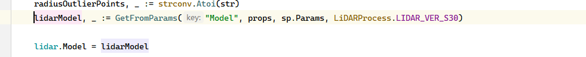
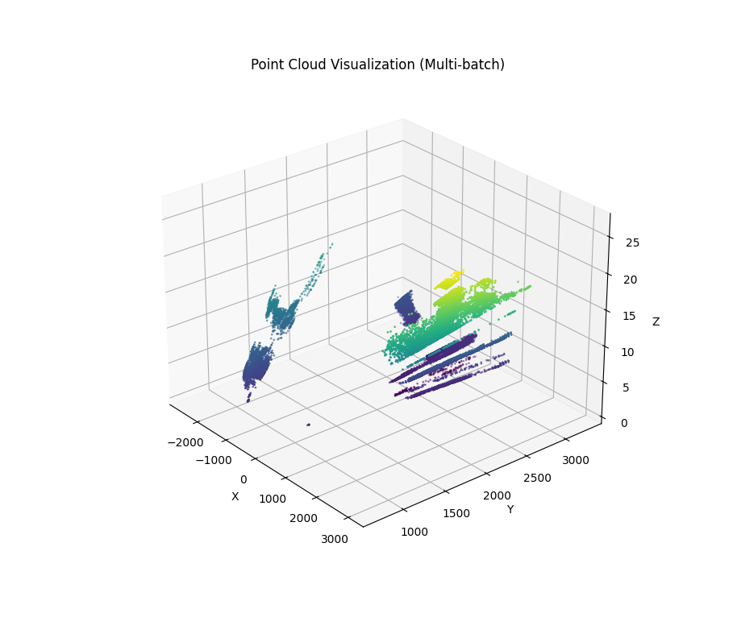

## EZ6雷达接入

EZ6文档：[地址](http://10.8.30.22/FS-IOT/trunk/doc/%E6%8A%80%E6%9C%AF%E6%96%87%E6%A1%A3/ZVISION%20EZ6%E4%BA%A7%E5%93%81%E6%89%8B%E5%86%8CV1.0_20250214.pdf)


Demo地址：

>  Iota\trunk\code\gowork\src\towercrane\deploy\LiDARProcess\LidarTest
>
> 实现本地EZ6设备接入。点云数据存储到文件


塔吊防碰撞中使用：

```golang
LiDARProcess.HandleFunc(udp, 1*time.Second, OnPoints, LiDARProcess.LIDAR_VER_EZ6)
```

在Lidar的Model参数中设置：



配置文件sensors.json中指定Model(S30、EZ6)：

```json
{
    "device": "激光雷达",
    "type": "lidar",
    "fields": null,
    "initValue": null,
    "code": 2368,
    "enabled": true,
    "position": {
      "X": 5,
      "Y": 0.800000011920929,
      "Z": 0.10000000149011612
    },
    "params": {
      "Direction": "LEFT",
      "Model": "S30",
      "RadiusOutlierDis": "",
      "RadiusOutlierPoints": "0",
      "SegmentDis": "0",
      "SegmentPoints": "0",
      "SegmentVol": "0",
      "VoxelGridLeafSize": "0"
    },
    "posture": {
      "Heading": 27,
      "Pitch": 0,
      "Roll": 0
    },
    "lidar_range": {
      "dis_min": 0,
      "dis_max": 100,
      "azimuth_max": 70,
      "azimuth_min": -70,
      "elevation_max": 20,
      "elevation_min": -50
    }
  }
```


python回放点云

```python
import pandas as pd
import matplotlib.pyplot as plt
from mpl_toolkits.mplot3d import Axes3D
import time

# 读取 CSV 文件
df = pd.read_csv("C:\\Users\\yww08\\Desktop\\points.csv")

# 按照 timestamp 分组（每批点云是一帧）
groups = df.groupby("timestamp")

# 初始化图形
fig = plt.figure(figsize=(10, 8))
ax = fig.add_subplot(111, projection='3d')

# 可选：启用交互式模式
plt.ion()

for ts, group in groups:
    ax.clear()  # 清空之前的图
    x = group['x']
    y = group['y']
    z = group['z']

    ax.scatter(x, y, z, c=z, cmap='viridis', s=1)
    ax.set_xlabel('X')
    ax.set_ylabel('Y')
    ax.set_zlabel('Z')
    ax.set_title(f'Point Cloud Frame @ {ts}')

    plt.draw()
    plt.pause(0.5)  # 暂停时间模拟帧间隔（可调整播放速度）

plt.ioff()
plt.show()

```


