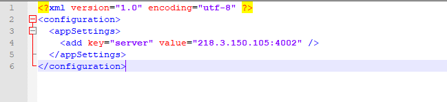
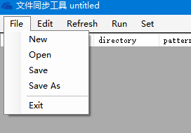
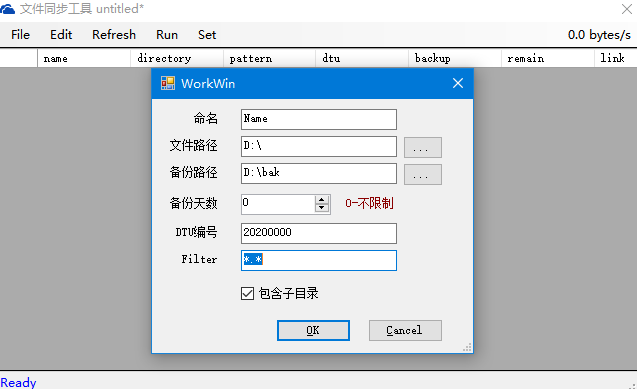
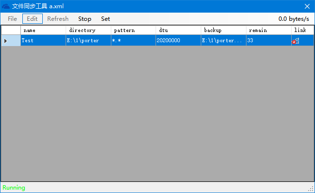
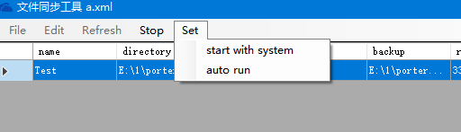
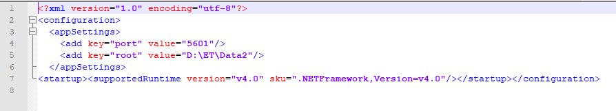
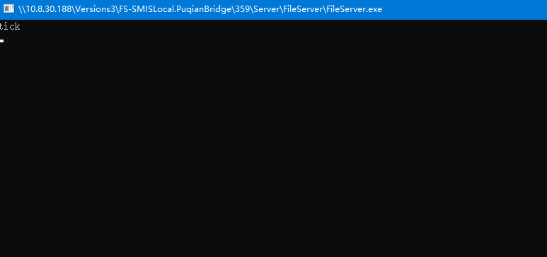

## `FileTransport` （`idau.tool`文件传输替代品）

构建： http://10.8.30.188:8080/view/1.SMISLocal/job/FS-SMISLocal.PuqianBridge/

版本

`\\10.8.30.188\Versions3\FS-SMISLocal.PuqianBridge\359\Server\FileServer`

`\\10.8.30.188\Versions3\FS-SMISLocal.PuqianBridge\359\Server\FileTransport`

功能，实现类似`idau.tool`的文件传输，服务端按照指定编号存储到指定文件夹。包括组件：

`FileTransport.exe` - 客户端传输工具

`FileServer.exe` - 服务端数据接收工具

#### 使用说明

##### 客户端

配置文件 `FileTransport.exe.config`配置服务端的地址。

启动 `FileTransport.exe`程序。选择【File】管理配置文件

选择【Edit】>【New】新增传输对象

配置完成后点击【Run】执行

其中：

remain： 还存在多少文件待传输

link：显示当前连接状态。

并且在菜单栏右侧会显示实时传输速率。

设置：

点击【Set】可以设置随系统启动和自动运行，建议均打开。

##### 服务端

配置文件 `FileServer.exe.config`：

port: 启动TCP的监听端口

root：数据存储的根目录（一般配置到ET解析的source目录）

启动 `FileServer.exe`

