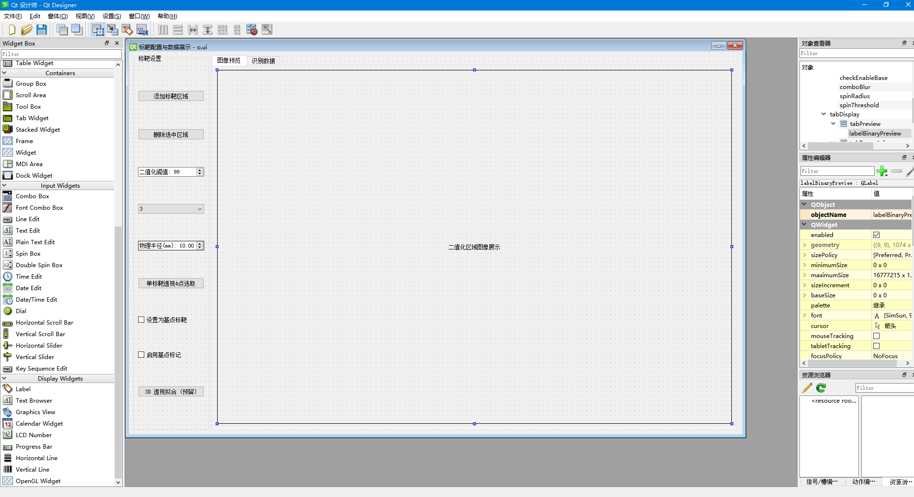

#### PyQt

新建项目，创建venv.

安装PyQy

```sh
pip install PyQt5
```

编写示例1：

```python
import sys
from PyQt5.QtWidgets import QApplication, QMainWindow, QLabel

class MyMainWindow(QMainWindow):
    def __init__(self):
        super().__init__()
        self.setWindowTitle("我的第一个 PyQt5 应用")
        self.setGeometry(100, 100, 600, 400)  # 设置窗口位置和大小

        self.initUI()

    def initUI(self):
        label = QLabel("你好，PyQt5！", self)
        label.move(250, 180)  # 移动 label 到窗口中心附近

if __name__ == "__main__":
    app = QApplication(sys.argv)
    window = MyMainWindow()
    window.show()
    sys.exit(app.exec_())
```

在项目根目录下运行：

```bash
python main.py
```

你将看到一个简单的 PyQt5 窗口，显示一行文字。

用 Qt Designer 创建 UI（进阶）:

```sh
# 安装设计器（如果还没有）
pip install pyqt5-tools

# 运行 Qt Designer（Windows 示例）
pyqt5-tools designer

# 保存为 .ui 文件后，用命令转为 Python
pyuic5 your.ui -o ui_main_window.py
```



打包成exe

```sh
pip install pyinstaller

pyinstaller --noconsole --onefile main.py

```

