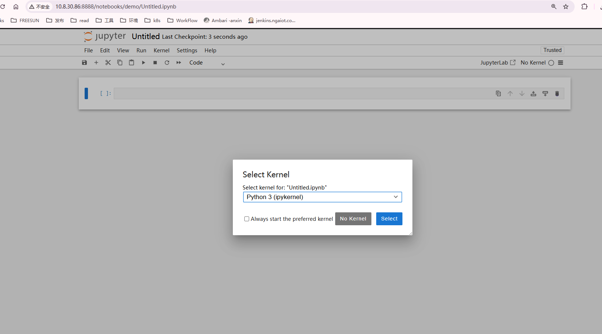

## pytorch

### 1、环境

使用pip

```sh
pip3 install torch torchvision torchaudio --index-url https://download.pytorch.org/whl/cu118
```


或者安装anaconda 、 或者 miniconda

验证：

```sh
conda --version
#​查看所有环境	conda env list
#​创建新环境	conda create --name myenv python=3.9
#​激活环境	conda activate myenv
#​退出环境	conda deactivate
#​安装包	conda install numpy
#​卸载包	conda remove numpy
#​查看已安装包	conda list

conda config --add channels https://mirrors.tuna.tsinghua.edu.cn/anaconda/pkgs/free/
conda config --set show_channel_urls yes

conda install pytorch torchvision torchaudio pytorch-cuda=11.8 -c pytorch -c nvidia

```

显卡环境

```shell
C:\Users\Administrator>nvidia-smi
Wed Mar 26 10:49:23 2025
+-----------------------------------------------------------------------------+
| NVIDIA-SMI 516.94       Driver Version: 516.94       CUDA Version: 11.7     |
|-------------------------------+----------------------+----------------------+
| GPU  Name            TCC/WDDM | Bus-Id        Disp.A | Volatile Uncorr. ECC |
| Fan  Temp  Perf  Pwr:Usage/Cap|         Memory-Usage | GPU-Util  Compute M. |
|                               |                      |               MIG M. |
|===============================+======================+======================|
|   0  NVIDIA GeForce ... WDDM  | 00000000:01:00.0  On |                  N/A |
| 44%   35C    P8    22W / 160W |    341MiB /  6144MiB |      4%      Default |
|                               |                      |                  N/A |
+-------------------------------+----------------------+----------------------+

+-----------------------------------------------------------------------------+
| Processes:                                                                  |
|  GPU   GI   CI        PID   Type   Process name                  GPU Memory |
|        ID   ID                                                   Usage      |
|=============================================================================|
|    0   N/A  N/A      1340    C+G   ...5n1h2txyewy\SearchApp.exe    N/A      |
|    0   N/A  N/A     12556    C+G   ...tem32\MicrosoftEdgeCP.exe    N/A      |
|    0   N/A  N/A     15128    C+G   ...3d8bbwe\MicrosoftEdge.exe    N/A      |
|    0   N/A  N/A     15408    C+G   ...al\Programs\Veee\Veee.exe    N/A      |
|    0   N/A  N/A     15816    C+G   ...tem32\MicrosoftEdgeCP.exe    N/A      |
|    0   N/A  N/A     18716    C+G   ...nputApp\TextInputHost.exe    N/A      |
|    0   N/A  N/A     22756    C+G   C:\Windows\explorer.exe         N/A      |
|    0   N/A  N/A     23128    C+G   ...me\Application\chrome.exe    N/A      |
|    0   N/A  N/A     23604    C+G   ...tem32\MicrosoftEdgeCP.exe    N/A      |
+-----------------------------------------------------------------------------+

C:\Users\Administrator>nvcc --version
nvcc: NVIDIA (R) Cuda compiler driver
Copyright (c) 2005-2022 NVIDIA Corporation
Built on Wed_Jun__8_16:59:34_Pacific_Daylight_Time_2022
Cuda compilation tools, release 11.7, V11.7.99
Build cuda_11.7.r11.7/compiler.31442593_0
```

验证Pytorch和GPU

```python
import torch
print(torch.__version__)            # 查看 PyTorch 版本
print(torch.cuda.is_available())    # 应输出 True（GPU 可用）
print(torch.cuda.get_device_name()) # 显示显卡型号（如 "NVIDIA GeForce RTX 3060"）
```


通过jupyter在有显卡的远程机器上执行python：

```sh
pip install jupyter

jupyter notebook --generate-config

jupyter notebook password

jupyter notebook --no-browser --ip=0.0.0.0 --port=8888 --allow-root --ServerApp.allow_remote_access=True
```

访问： http://10.8.30.86:8888/ 




>  同时使用了 Syncthing 进行了文件同步，这样我在本地用pycharm修改代码，就会同步到远程机器上。不再需要在浏览器中编辑python代码。

