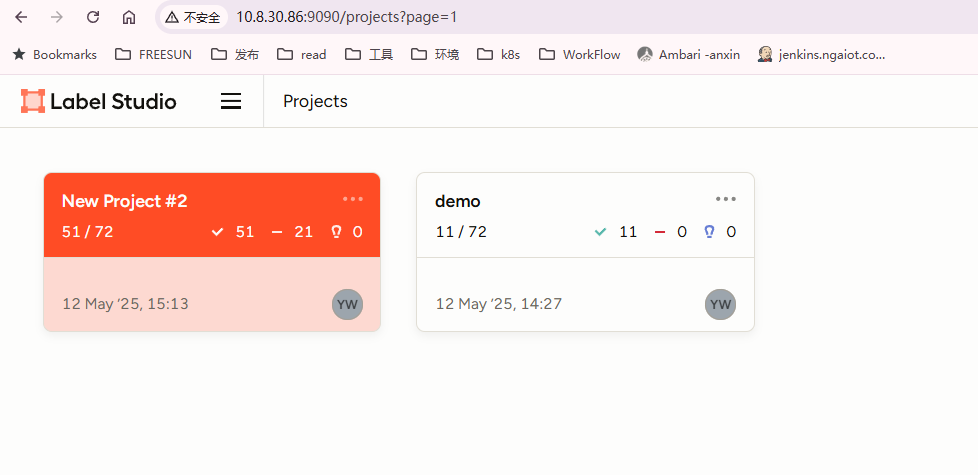
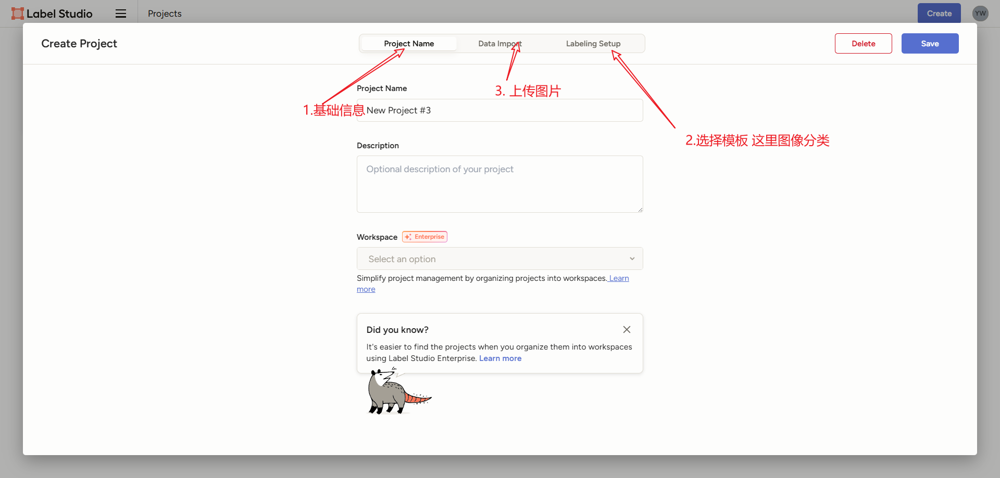
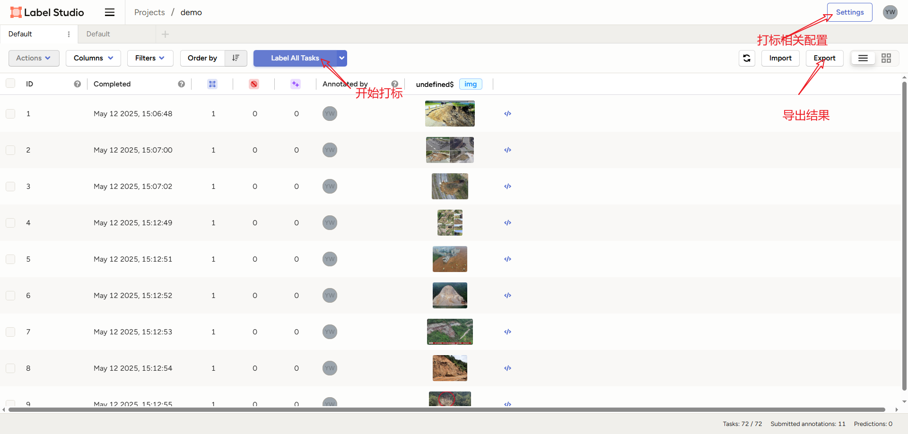

#### YOLO滑坡监测

> AIOP（AI开放平台） https://ai.hikvision.com/
>
> roboflow： https://app.roboflow.com/


安装**[label-studio](https://github.com/HumanSignal/label-studio)**

从Docker安装

```sh
docker pull heartexlabs/label-studio:latest
docker run -it -p 8080:8080 -v $(pwd)/mydata:/label-studio/data heartexlabs/label-studio:latest
```

从pip安装

```sh
# Requires Python >=3.8
pip install label-studio

# Start the server at http://localhost:8080
label-studio

label-studio --no-browser --host 0.0.0.0 --port 9090

```

使用poetry安装

```sh
### install poetry
pip install poetry

### set poetry environment
poetry new my-label-studio
cd my-label-studio
poetry add label-studio

### activate poetry environment
poetry shell

### Start the server at http://localhost:8080
label-studio
```

部署完访问：http://10.8.30.86:9090/projects/4/data/export









导出Mini-JSON,在用python脚本导出到训练集和验证集：

```sh
dataset/
├── train/
│   ├── 滑坡/
│   └── 正常/
└── val/
    ├── 滑坡/
    └── 正常/
```


安装pytorch参考 [Pytorch.md](./PyTorch.md)

> http://10.8.30.86:8888/ 
>
>nvidia-smi
>
>jupyter notebook --no-browser --ip=0.0.0.0 --port=8888 --allow-root --ServerApp.allow_remote_access=True
>
>```python
>import torch
>print(torch.__version__)            # 查看 PyTorch 版本
>print(torch.cuda.is_available())    # 应输出 True（GPU 可用）
>print(torch.cuda.get_device_name()) # 显示显卡型号（如 "NVIDIA GeForce RTX 3060"）
>```


图像资源下载：

zenodo：https://zenodo.org/search?q=landslide&l=list&p=1&s=10&sort=bestmatch


#### 附录

分类python

```python

```


yolov8环境安装

```sh
# 在86环境
conda create -n yolo_env python=3.10 -y
conda activate yolo_env

pip install ultralytics

yolo
```

