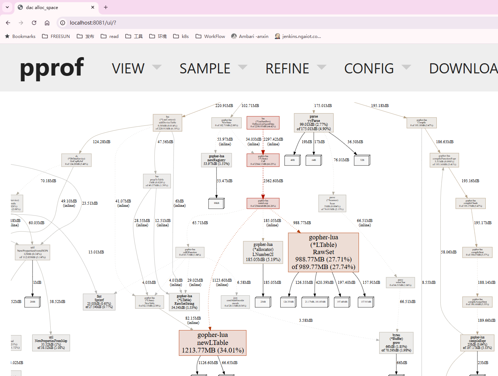
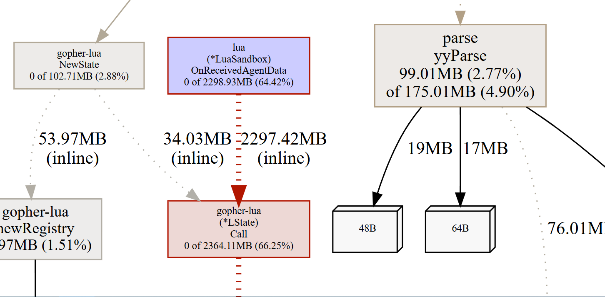
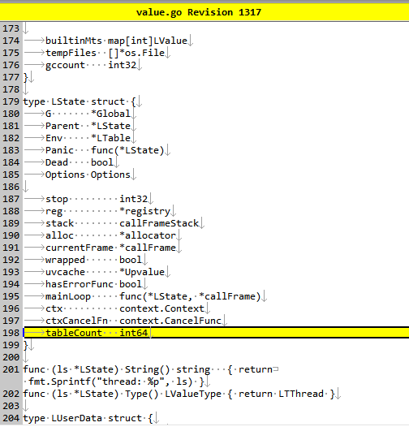
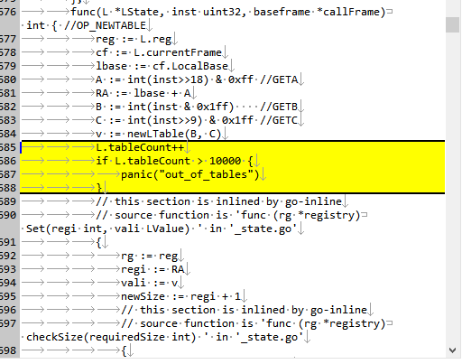
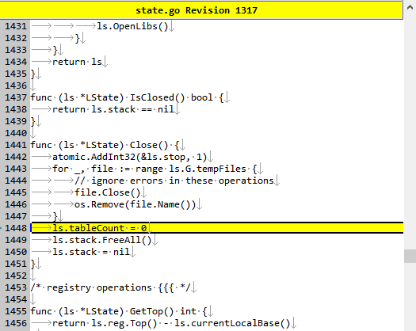

### golang内存溢出问题

iota-dac-11内存飙升到22G然后导致anxin-m2服务器OOM，出现问题。先通过限制Pod内存避免影响其他容器。

```sh
top -c
# [Shift+M] 查看内存较高的dac的pid

docker ps -q | xargs docker inspect --format '{{.Name}} {{.State.Pid}}'
```


思路：等到内存增长的时候，导出heap后到本地分析

远程到anxin-m1服务器

```sh
ki | grep dac-11

root@anxin-m1:/home/anxin# go tool pprof -proto http://10.244.2.230:19201/debug/pprof/heap > dac11.heap.pb.gz

```


导出后拷贝到本机分析

（1）用命令行 `pprof` 查看 top 函数：

```bash
go tool pprof heap.pb.gz
# 然后进入交互界面，可输入:
(pprof) top
(pprof) list <funcname>
```

（2）生成火焰图：

```bash
go tool pprof -http=:8081 heap.pb.gz
```

运行结果

```sh
C:\Users\yww08\Desktop>go tool pprof dac11.heap.pb.gz2
File: dac
Type: inuse_space
Time: Jul 22, 2025 at 4:20pm (CST)
Entering interactive mode (type "help" for commands, "o" for options)
(pprof) top
Showing nodes accounting for 1.45GB, 94.62% of 1.54GB total
Dropped 178 nodes (cum <= 0.01GB)
Showing top 10 nodes out of 83
      flat  flat%   sum%        cum   cum%
       1GB 65.38% 65.38%        1GB 65.38%  github.com/yuin/gopher-lua.newLTable
    0.19GB 12.56% 77.93%     0.19GB 12.59%  github.com/yuin/gopher-lua.(*LTable).RawSet
    0.07GB  4.45% 82.38%     0.09GB  6.17%  github.com/yuin/gopher-lua.newFuncContext
    0.04GB  2.85% 85.23%     0.04GB  2.85%  github.com/yuin/gopher-lua.newRegistry 
```

| 列名       | 含义                                                         |
| ---------- | ------------------------------------------------------------ |
| `flat`     | 该函数本身直接分配的内存（不包括它调用的其他函数）。这是最关键的“元凶”指标。 |
| `flat%`    | 上面这部分内存占总内存的百分比。用于快速判断这个函数有多“重”。 |
| `sum%`     | 所有前面函数的 `flat%` 加总。例如第二行是 58.46%，表示加到目前为止的前两行已占总内存的 58.46%。 |
| `cum`      | 累计分配内存：包括该函数以及其调用链上的所有函数分配的内存总和（调用深度统计）。 |
| `cum%`     | `cum` 占总内存的百分比。                                     |
| `function` | 分配内存的函数路径（包路径 + 函数名）。这就是你需要重点关注的“可疑”函数。 |


```sh
root@anxin-m1:/home/anxin# go tool pprof -proto http://10.244.2.230:19201/debug/pprof/allocs > dac11.alloc.pb.gz

(pprof) list newLTable
Total: 3.48GB
ROUTINE ======================== github.com/yuin/gopher-lua.newLTable in \go\pkg\mod\github.com\yuin\gopher-lua@v0.0.0-20210529063254-f4c35e4016d9\table.go
    1.19GB     1.19GB (flat, cum) 34.01% of Total
         .          .     33:           acap = 0
         .          .     34:   }
         .          .     35:   if hcap < 0 {
         .          .     36:           hcap = 0
         .          .     37:   }
    1.10GB     1.10GB     38:   tb := &LTable{}
         .          .     39:   tb.Metatable = LNil
         .          .     40:   if acap != 0 {
   14.01MB    14.01MB     41:           tb.array = make([]LValue, 0, acap)
         .          .     42:   }
         .          .     43:   if hcap != 0 {
   73.16MB    73.16MB     44:           tb.strdict = make(map[string]LValue, hcap)
         .          .     45:   }
         .          .     46:   return tb
         .          .     47:}
         .          .     48:
         .          .     49:// Len returns length of this LTable.
(pprof) callers github.com/yuin/gopher-lua.newLTable
unrecognized command: "callers"
```

还是找不到我们的代码位置。

```sh
go tool pprof -http=:8081 dac11.alloc.pb.gz3
```






你看到的：

```
bash复制编辑ROUTINE ======================== iota/driver/lua.(*LuaSandbox).OnReceivedAgentData
     0     2.25GB (flat, cum) 64.42% of Total
```

仅显示了内存量，还需要：

```
sh


复制编辑
(pprof) top -alloc_objects
```

如果 `OnReceivedAgentData` 出现在 alloc_objects 很高的前列，说明是“频繁调用”。


推测：可能是某次数据触发 `OnReceivedAgentData` 后脚本里面执行内存较高。

✅ 推荐设置（间接限制内存）

| 字段                  | 含义                                     | 建议                                           |
| --------------------- | ---------------------------------------- | ---------------------------------------------- |
| `CallStackSize`       | Lua 调用栈初始大小（函数嵌套深度）       | 建议设置小一点（例如 64 或 128），限制递归深度 |
| `RegistrySize`        | Lua 的寄存器（全局变量、闭包等）初始大小 | 建议设置合理（默认值一般够用，如 1024）        |
| `RegistryMaxSize`     | 寄存器的最大大小（限制扩容）             | 设置一个上限，例如 4096，防止无限增长          |
| `RegistryGrowStep`    | 每次扩容步长                             | 保持默认（或者根据 `RegistryMaxSize` 控制）    |
| `MinimizeStackMemory` | 自动缩减 call stack 空间                 | 设置为 `true` 以节省内存，但略有性能损耗       |


发现这些并不能真正限制内存。

索性下载了gopher.lua库的代码，实现二次开发：

限制newLTable的创建个数








其他：

这些内容都可以通过 HTTP 接口（如果你的程序已开启 pprof 服务）或程序内导出：

| 分析项       | 路径（假设监听端口为6060）                             | 描述                               |
| ------------ | ------------------------------------------------------ | ---------------------------------- |
| heap         | `http://localhost:6060/debug/pprof/heap`               | 当前内存快照，查看对象占用内存情况 |
| allocs       | `http://localhost:6060/debug/pprof/allocs`             | 历史分配路径，定位谁分配了内存     |
| goroutine    | `http://localhost:6060/debug/pprof/goroutine`          | 查看当前所有 goroutine 堆栈        |
| threadcreate | `http://localhost:6060/debug/pprof/threadcreate`       | 查看创建线程的情况                 |
| block        | `http://localhost:6060/debug/pprof/block`              | 哪些地方阻塞了 goroutine           |
| profile      | `http://localhost:6060/debug/pprof/profile?seconds=30` | CPU 分析（采样 30 秒）             |