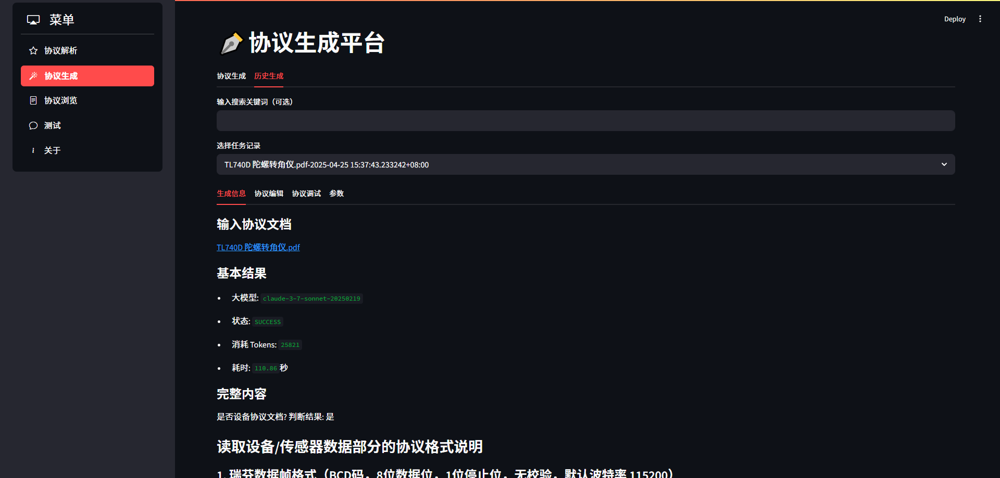
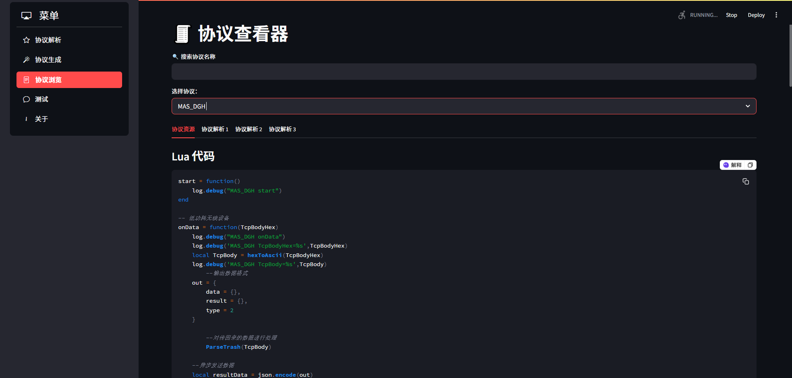

## 协议自动化平台实现方案

该平台采用 **Streamlit** 实现交互界面，支持协议文档上传、结构解析、特征抽取和代码生成四大功能模块。背后集成了两类大模型服务：

- **通义千问（Qwen-Long）**：擅长长文档解析，主要用于读取协议内容、提取特征。
- **Claude 3.5 Sonnet**：用于根据协议特征生成符合规范的脚本，生成iota协议解析Lua脚本。

此外，平台还集成七牛云文件存储和PostgreSQL记录历史任务信息，实现任务可追溯与内容可视化。






**协议解析流程详解**

1. **文档上传与处理**： 用户上传 `txt/pdf/docx/csv/json` 协议文件，系统临时存储并上传至模型或云端，生成文件URL用于后续展示。
2. **协议结构理解**： 利用 `fileid://` 形式将文档输入 `Qwen` 模型，系统提示模型“理解协议文档结构”。该过程支持流式响应展示，增强用户反馈体验。
3. **协议特征提取**： 若文档被识别为设备通信协议，系统会进一步提示模型提炼字段如地址、功能码、寄存器结构等。
4. **协议脚本生成**： 提取结果将再次输入 Claude 模型，根据具体协议类型（Modbus、MQTT等）自动生成标准化协议脚本，如 Lua 格式。
5. **计费与性能反馈**： 系统会统计调用模型的 Token 数量，结合价格策略给出预估费用，并展示处理时长等性能指标。

其中采用了：

- **流式响应处理**：通过 `stream=True` 实现模型响应的实时渲染，避免用户等待过程中的空白体验。
- **多轮对话引导模型生成**：通过多轮对话引导模型逐步完成复杂任务，如从结构解析到特征提炼再到脚本生成。
- **内容识别与条件分支**：利用正则或预定义判断函数识别文档是否属于通信协议，非协议文档将跳过生成步骤，提升效率与准确率。
- **多模型集成策略**：根据任务特点选择适配模型，如 Claude 更擅长生成结构化代码，而 `Qwen` 适用于长文本阅读与理解。

```python
with st.spinner("正在请求模型分析，请稍候..."):
    try:
        message_placeholder = st.empty()
        messages = [
            {'role': 'system', 'content': f'fileid://{file_object.id}'},
            {'role': 'user', 'content': protocol_file_parse_prompt()},
        ]
        completion = client_ali.chat.completions.create(
            model=MODEL_NAME_PARSE_FILE,
            messages=messages,
            stream=True,
            stream_options={"include_usage": True}
        )
        completion_content = ""
        # 处理流式响应
        for chunk in completion:
            if chunk.choices and chunk.choices[0].delta.content:
                content = chunk.choices[0].delta.content
                completion_content += content
                st.session_state.full_response += content
                message_placeholder.markdown(st.session_state.full_response + "▌")
                if chunk.usage:
                    if chunk.usage.prompt_tokens:
                        input_tokens += chunk.usage.prompt_tokens
                        if chunk.usage.completion_tokens:
                            output_tokens += chunk.usage.completion_tokens
                            if chunk.usage.total_tokens:
                                total_tokens += chunk.usage.total_tokens
```

