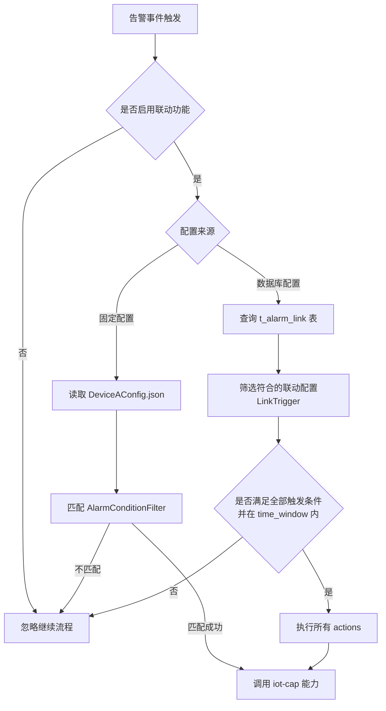

## 告警联动说明

当前系统支持两种告警联动能力，用于在特定告警产生时触发设备能力调用（`iot-cap`）等联动行为：

------

### **1. 固定代码配置方式（读取本地 `DeviceAConfig.json`）**

- **适用场景**：仅针对“告警产生”事件，自动判断是否满足联动条件并触发。**用于指定结构物下告警产生，触发设备能力调用的场景**
- **配置方式**：通过读取固定路径下的 `DeviceAConfig.json` 文件。
- **示例配置**：

```json
{
  "iotaDeviceMetaId": "d6f6cb30-5eb0-44a7-928e-6b95daad89f3",
  "capMetaId": "f3bb4300-32dd-4815-8a8b-b294ff46c809",
  "param": "1",
  "filter": {
    "categories": [2],
    "status": [1, 2]
  }
}
```

- **含义说明**：

  - `iotaDeviceMetaId`：指定联动设备原型ID。
  - `capMetaId`：指定能力原型ID。
  - `param`：能力调用的参数。
  - `filter`：告警筛选条件（需全部满足）：
    - `categories`：告警分类（如数据类为2，参考 `AlarmCategory`）。
    - `status`：告警状态（如待确认1，已确认2，参考 `AlarmStatus`）。
    - 其他支持字段（如 `structures`, `types`, `states`, `levels`）可按需扩展。

- **筛选字段支持的定义**：

  ```scala
  case class AlarmConditionFilter(
      structures: Array[Int],
      types: Array[String],
      categories: Array[Int],
      status: Array[Int],
      states: Array[Int],
      levels: Array[Int] = null
  )
  ```

------

### **2. 数据库动态配置方式（t_alarm_link 表）**

- **适用场景**：支持更灵活的联动定义，配置在数据库中，可热更新。
- **表结构字段（以JSON示意）**：

```json
{
  "name": "固原监控中心-5225",
  "time_window": "2 hours",
  "triggers": [
    {
      "structure": 5225,
      "categories": [2],
      "status": [1, 2]
    },
    {
      "source": "abc",
      "alarm_type": "3007"
    }
  ],
  "actions": [
    {
      "type": "iot-cap",
      "parameters": {
        "body": {
          "param": "1",
          "thingId": "...",
          "deviceId": "...",
          "dimCapId": "...",
          "timeout": 10000
        }
      }
    }
  ]
}
```

- **字段说明**：

  - `name`：联动配置名称。

  - `time_window`：触发条件满足的时间窗口，表示多个条件需在此时间范围内共同满足。

  - `triggers`：触发条件数组，多个条件为“与”关系，字段支持如下：

    ```scala
    case class LinkTrigger(
        structure: Option[Int],
        source: Option[String],
        types: Option[Array[String]],
        categories: Option[Array[Int]],
        status: Option[Array[Int]],
        states: Option[Array[Int]],
        levels: Option[Array[Int]] = None
    )
    ```

    > source 和 structure必须有且仅有一个配置，限定告警发生的范围。

  - `actions`：当前仅支持 `iot-cap` 动作，表示调用能力。参数结构如下：

    ```json
    {
      "type": "iot-cap",
      "parameters": {
        "body": {
          "deviceId": "设备ID",
          "param": "能力参数",
          "thingId": "物模型ID",
          "dimCapId": "能力定义ID",
          "timeout": 10000
        }
      }
    }
    ```

------

## 枚举定义说明（关键字段值参考）

`AlarmStatus`（告警状态）

| 状态值 | 名称   | 含义             |
| ------ | ------ | ---------------- |
| 1      | 待确认 | 待人工确认处理   |
| 2      | 已确认 | 已确认有效       |
| 3      | 未通过 | 审核未通过或驳回 |

`AlarmState`（告警生命周期状态）

| 状态值 | 名称         | 含义           |
| ------ | ------------ | -------------- |
| 0      | 新告警       | 新增告警事件   |
| 1      | 次数更新     | 告警次数递增   |
| 2      | 等级提升     | 告警等级升级   |
| 3      | 自动恢复     | 系统自动恢复   |
| 4      | 手动恢复     | 人工确认恢复   |
| 5      | 已恢复待确认 | 需审核是否恢复 |

`AlarmCategory`（告警分类）

| 值   | 名称   |
| ---- | ------ |
| 1    | 设备类 |
| 2    | 数据类 |
| 3    | 开发类 |
| 4    | 系统类 |

`AlarmSourceType`（告警来源类型）

| 值   | 名称 |
| ---- | ---- |
| 1    | 设备 |
| 3    | 测点 |
| 4    | 系统 |

------





