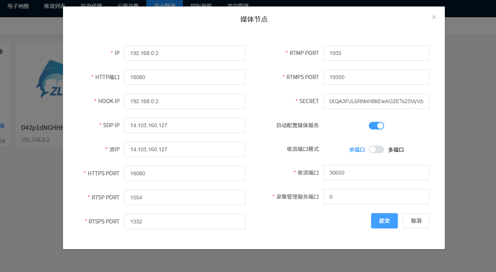

#### 拉镜像

拉取镜像报错了。`registry.ngaiot.com` 使用的是自签名证书（而非公共 CA 签发的证书），你需要手动将其证书添加到系统的信任链中，才能让 `curl`、`docker` 等工具信任该仓库。以下是详细步骤：

```sh
root@iv-ydtrju48w0wuxjsooe7j:~# curl -v https://registry.ngaiot.com/v2/

* Host registry.ngaiot.com:443 was resolved.
* IPv6: (none)
* IPv4: 222.186.227.196
* Trying 222.186.227.196:443...
* Connected to registry.ngaiot.com (222.186.227.196) port 443
* ALPN: curl offers h2,http/1.1
* TLSv1.3 (OUT), TLS handshake, Client hello (1):
* CAfile: /etc/ssl/certs/ca-certificates.crt
* CApath: /etc/ssl/certs
* Recv failure: Connection reset by peer
* OpenSSL SSL_connect: Connection reset by peer in connection to registry.ngaiot.com:443 
* Closing connection
  curl: (35) Recv failure: Connection reset by peer
```


下载证书
    openssl s_client -connect registry.ngaiot.com:443 -showcerts </dev/null 2>/dev/null | \
       sed -n '/BEGIN CERTIFICATE/,/END CERTIFICATE/p' > registry.ngaiot.com.crt
        
    sudo cp registry.ngaiot.com.crt /usr/local/share/ca-certificates/
    sudo update-ca-certificates
    
    

报错again：
```sh
root@iv-ydtrju48w0wuxjsooe7j:~# curl -v https://registry.ngaiot.com/v2/
* Host registry.ngaiot.com:443 was resolved.
* IPv6: (none)
* IPv4: 222.186.227.196
*   Trying 222.186.227.196:443...
* Connected to registry.ngaiot.com (222.186.227.196) port 443
* ALPN: curl offers h2,http/1.1
* TLSv1.3 (OUT), TLS handshake, Client hello (1):
*  CAfile: /etc/ssl/certs/ca-certificates.crt
*  CApath: /etc/ssl/certs
* TLSv1.3 (IN), TLS handshake, Server hello (2):
* TLSv1.3 (IN), TLS handshake, Encrypted Extensions (8):
* TLSv1.3 (IN), TLS handshake, Certificate (11):
* TLSv1.3 (IN), TLS handshake, CERT verify (15):
* TLSv1.3 (IN), TLS handshake, Finished (20):
* TLSv1.3 (OUT), TLS change cipher, Change cipher spec (1):
* TLSv1.3 (OUT), TLS handshake, Finished (20):
* SSL connection using TLSv1.3 / TLS_AES_256_GCM_SHA384 / X25519 / RSASSA-PSS
* ALPN: server accepted h2
* Server certificate:
*  subject: CN=*.ngaiot.com
*  start date: Feb  8 00:00:00 2025 GMT
*  expire date: Feb 20 23:59:59 2026 GMT
*  subjectAltName: host "registry.ngaiot.com" matched cert's "*.ngaiot.com"
*  issuer: C=US; O=DigiCert Inc; OU=www.digicert.com; CN=Encryption Everywhere DV TLS CA - G2
*  SSL certificate verify ok.
*   Certificate level 0: Public key type RSA (2048/112 Bits/secBits), signed using sha256WithRSAEncryption
*   Certificate level 1: Public key type RSA (2048/112 Bits/secBits), signed using sha256WithRSAEncryption
*   Certificate level 2: Public key type RSA (2048/112 Bits/secBits), signed using sha256WithRSAEncryption
* using HTTP/2
* [HTTP/2] [1] OPENED stream for https://registry.ngaiot.com/v2/
* [HTTP/2] [1] [:method: GET]
* [HTTP/2] [1] [:scheme: https]
* [HTTP/2] [1] [:authority: registry.ngaiot.com]
* [HTTP/2] [1] [:path: /v2/]
* [HTTP/2] [1] [user-agent: curl/8.5.0]
* [HTTP/2] [1] [accept: */*]
> GET /v2/ HTTP/2
> Host: registry.ngaiot.com
> User-Agent: curl/8.5.0
> Accept: */*
> 
* TLSv1.3 (IN), TLS handshake, Newsession Ticket (4):
* TLSv1.3 (IN), TLS handshake, Newsession Ticket (4):
* old SSL session ID is stale, removing
< HTTP/2 401 
< date: Mon, 28 Apr 2025 08:43:05 GMT
< content-type: application/json; charset=utf-8
< content-length: 76
< docker-distribution-api-version: registry/2.0
< set-cookie: sid=975473da666830a9ac605f8e7021f483; Path=/; HttpOnly
< www-authenticate: Bearer realm="https://registry.ngaiot.com/service/token",service="harbor-registry"
< x-request-id: 28f0987989ee6ae44f2a2914741cef98
< strict-transport-security: max-age=15724800; includeSubDomains
< 
{"errors":[{"code":"UNAUTHORIZED","message":"unauthorized: unauthorized"}]}
* Connection #0 to host registry.ngaiot.com left intact
```
拉取镜像

```sh
docker login registry.ngaiot.com

root@iv-ydtrju48w0wuxjsooe7j:~# docker pull registry.ngaiot.com/zhiwucloud/wvp:8


```


用docker-compose部署

```yaml
# Please see the README.md for instructions as to how to use and customize.

# NOTE: This file does not build! No dockerfiles are set. See the README.md in this directory.
---
version: '3.8'
services:
  redis:
    image: redis:latest
    hostname: redis
    container_name: redis
    ports:
      - "6379:6379" 

  db:
    image: postgres
    hostname : pg
    restart: always
    environment:
      POSTGRES_PASSWORD: fox123456
    ports:
      - "5432:5432"
    volumes:
      - /root/wvp/pgdata:/var/lib/postgresql/data

  wvp:
    image: registry.ngaiot.com/zhiwucloud/wvp:8
    hostname : wvp
    container_name: wvp
    restart: always
    ports:
      - "32188:32188"
      - "32339:32339"
      - "32339:32339/udp"
    volumes:
      - /root/wvp/wvpconf/:/app/config/
      
  zlm:
    image: zlmediakit/zlmediakit:master
    hostname : zlm
    restart: always
    environment:
      POSTGRES_PASSWORD: fox123456
    ports:
      - "18080:8080"
      - "18000:8000"
      - "18080:8080/udp"
      - "11935:1935"
      - "30050:30050"
        #- "30000-30100:30000-30100/udp"
    volumes:
      - /root/wvp/zlmconf22/:/opt/media/conf/
      
      
networks:
  default:
    name: default_network2

```


模拟调试工具：

```sh
[github](gb28181Simulator-master)


```


其中配置：

WVP配置略。


ZLM配置如下：（修改了很多port和Hook地址）

```ini
; auto-generated by mINI class {

[api]
apiDebug=1
defaultSnap=./www/logo.png
downloadRoot=./www
secret=tXQA3PJL6RNnH8kEwAG2ETs25VyVzrJn
snapRoot=./www/snap/

[cluster]
origin_url=
retry_count=3
timeout_sec=15

[ffmpeg]
bin=/usr/bin/ffmpeg
cmd=%s -re -i %s -c:a aac -strict -2 -ar 44100 -ab 48k -c:v libx264 -f flv %s
log=./ffmpeg/ffmpeg.log
restart_sec=0
snap=%s -rtsp_transport tcp -i %s -y -f mjpeg -t 0.001 %s

[general]
broadcast_player_count_changed=0
check_nvidia_dev=1
enableVhost=0
enable_ffmpeg_log=0
flowThreshold=1024
listen_ip=::
maxStreamWaitMS=15000
mediaServerId=D42p1dNGHH6jyleL
mergeWriteMS=0
resetWhenRePlay=1
streamNoneReaderDelayMS=20000
unready_frame_cache=100
wait_add_track_ms=3000
wait_audio_track_data_ms=1000
wait_track_ready_ms=10000

[hls]
broadcastRecordTs=0
deleteDelaySec=10
fastRegister=0
fileBufSize=65536
segDelay=0
segDur=2
segKeep=0
segNum=3
segRetain=5

[hook]
alive_interval=30.000000
enable=1
on_flow_report=
on_http_access=http://192.168.0.2:32188/index/hook/on_http_access
on_play=http://192.168.0.2:32188/index/hook/on_play
on_publish=http://192.168.0.2:32188/index/hook/on_publish
on_record_mp4=
on_record_ts=http://192.168.0.2:32188/index/hook/on_record_ts
on_rtp_server_timeout=http://192.168.0.2:32188/index/hook/on_rtp_server_timeout
on_rtsp_auth=http://192.168.0.2:32188/index/hook/on_rtsp_auth
on_rtsp_realm=http://192.168.0.2:32188/index/hook/on_rtsp_realm
on_send_rtp_stopped=http://192.168.0.2:32188/index/hook/on_send_rtp_stopped
on_server_exited=http://192.168.0.2:32188/index/hook/on_server_exited
on_server_keepalive=http://192.168.0.2:32188/index/hook/on_server_keepalive
on_server_started=http://192.168.0.2:32188/index/hook/on_server_started
on_shell_login=http://192.168.0.2:32188/index/hook/on_shell_login
on_stream_changed=http://192.168.0.2:32188/index/hook/on_stream_changed
on_stream_none_reader=http://192.168.0.2:32188/index/hook/on_stream_none_reader
on_stream_not_found=http://192.168.0.2:32188/index/hook/on_stream_not_found
retry=1
retry_delay=3.000000
stream_changed_schemas=rtsp/rtmp/fmp4/ts/hls/hls.fmp4
timeoutSec=20

[http]
allow_cross_domains=1
allow_ip_range=::1,127.0.0.1,172.16.0.0-172.31.255.255,192.168.0.0-192.168.255.255,10.0.0.0-10.255.255.255
charSet=utf-8
dirMenu=1
forbidCacheSuffix=
forwarded_ip_header=
keepAliveSecond=15
maxReqSize=40960
notFound=<html><head><title>404 Not Found</title></head><body bgcolor="white"><center><h1>您访问的资源不存在！</h1></center><hr><center>ZLMediaKit(git hash:ab14adb/2025-04-26T19:58:48+08:00,branch:master,build time:2025-04-26T11:59:56)</center></body></html>
port=8080
rootPath=./www
sendBufSize=65536
sslport=443
virtualPath=

[multicast]
addrMax=239.255.255.255
addrMin=239.0.0.0
udpTTL=64

[protocol]
add_mute_audio=1
auto_close=0
continue_push_ms=3000
enable_audio=1
enable_fmp4=1
enable_hls=1
enable_hls_fmp4=0
enable_mp4=0
enable_rtmp=1
enable_rtsp=1
enable_ts=1
fmp4_demand=0
hls_demand=0
hls_save_path=./www
modify_stamp=2
mp4_as_player=0
mp4_max_second=3600
mp4_save_path=./www
paced_sender_ms=0
rtmp_demand=0
rtsp_demand=0
ts_demand=0

[record]
appName=record
enableFmp4=0
fastStart=0
fileBufSize=65536
fileRepeat=0
sampleMS=500

[rtc]
bfilter=0
datachannel_echo=1
externIP=
maxRtpCacheMS=5000
maxRtpCacheSize=2048
max_bitrate=0
min_bitrate=0
nackIntervalRatio=1.000000
nackMaxCount=15
nackMaxMS=3000
nackMaxSize=2048
nackRtpSize=8
port=8000
preferredCodecA=PCMA,PCMU,opus,mpeg4-generic
preferredCodecV=H264,H265,AV1,VP9,VP8
rembBitRate=0
start_bitrate=0
tcpPort=8000
timeoutSec=15

[rtmp]
directProxy=1
enhanced=0
handshakeSecond=15
keepAliveSecond=15
port=1935
sslport=19350

[rtp]
audioMtuSize=600
h264_stap_a=1
lowLatency=0
rtpMaxSize=10
videoMtuSize=1400

[rtp_proxy]
dumpDir=
gop_cache=1
h264_pt=98
h265_pt=99
opus_pt=100
port=30050
port_range=30000-30100
ps_pt=96
rtp_g711_dur_ms=100
timeoutSec=15
udp_recv_socket_buffer=4194304

[rtsp]
authBasic=0
directProxy=1
handshakeSecond=15
keepAliveSecond=15
lowLatency=0
port=554
rtpTransportType=-1
sslport=332

[shell]
maxReqSize=1024
port=9000

[srt]
latencyMul=4
passPhrase=
pktBufSize=8192
port=9000
timeoutSec=5

; } ---

```

其中注意：

界面中配置节点，SDP地址必须是公网可访问的

