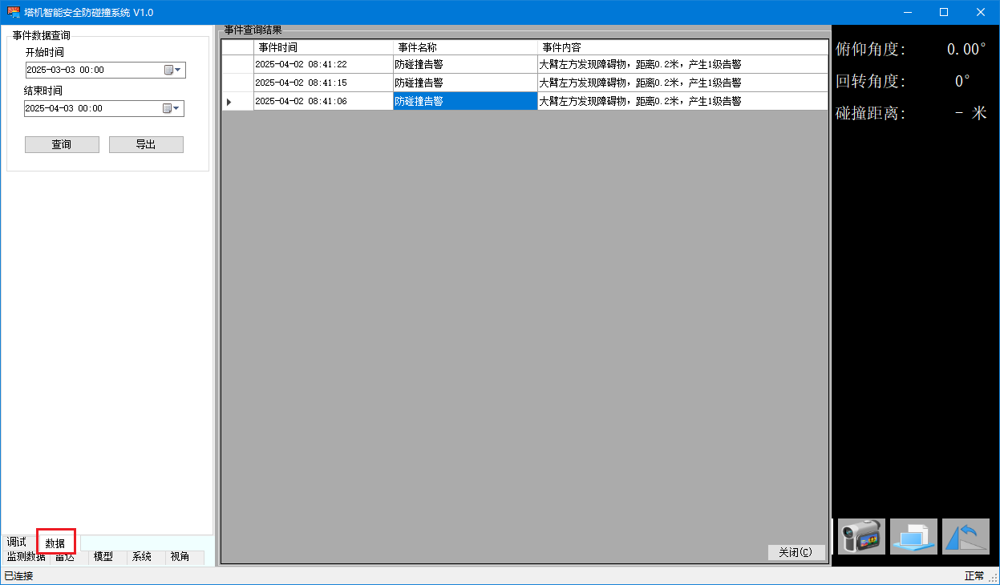

塔吊防碰撞系统数据导出功能

进入【数据】TAB页如下所示

选择需要导出的数据时间范围（默认为最近30天），然后执行【查询】。

|      | 时间                | 名称       | 内容                                       |
| ---- | ------------------- | ---------- | ------------------------------------------ |
| 1    | 2025-04-02 08:41:15 | 防碰撞告警 | 大臂左方发现障碍物，距离0.2米，产生1级告警 |
| 2    | 2025-04-02 08:41:06 | 防碰撞告警 | 大臂左方发现障碍物，距离0.2米，产生1级告警 |

数据按照时间倒序排列，展示内容如上表所示。

查询完成后，可以点击【导出】将数据导出到CSV文件格式。

