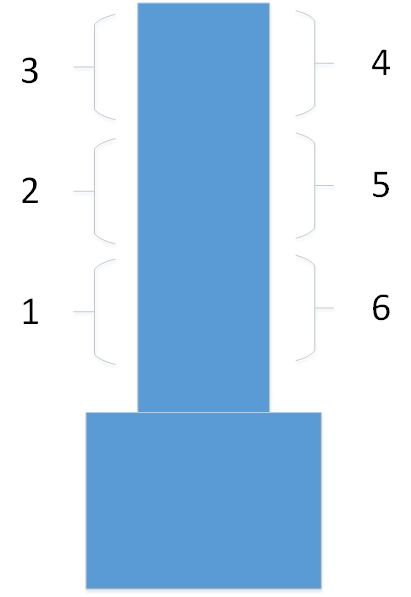

##  塔吊防碰撞距离输出Modbus RTU协议格式说明文档

### 协议概述

将大臂左右两侧区域划分为N个区间段，并给它们分别编号。如下。使用Modbus RTU协议通过串口发送与大臂存在碰撞风险的区域编号以及碰撞距离（最小距离）。




### 通信参数

- 波特率：9600 bps
- 数据位：8位
- 停止位：1位
- 校验位：无
- 从机地址：可配置（默认为1）

### 数据帧格式

#### 写多个寄存器命令 (功能码0x10)

| 字节序号 | 字段名称   | 长度 | 描述                    |
| -------- | ---------- | ---- | ----------------------- |
| 0        | 从机地址   | 1    | Modbus从机地址          |
| 1        | 功能码     | 1    | 0x10 (写多个寄存器)     |
| 2-3      | 起始地址   | 2    | 0x0000 (起始寄存器地址) |
| 4-5      | 寄存器数量 | 2    | 0x0004 (4个寄存器)      |
| 6        | 数据长度   | 1    | 0x08 (8字节数据)        |
| 7-8      | 区域编号   | 2    | 区域ID (大端序)         |
| 9-10     | 保留字节   | 2    | 0x00 0x00               |
| 11-14    | 最小距离   | 4    | 毫米单位 (大端序)       |
| 15-16    | CRC校验    | 2    | CRC16校验值 (小端序)    |

### 数据字段详细说明

#### 区域编号 (2字节)

- 范围：1-65535
- 格式：无符号16位整数，大端序
- 说明：区域的唯一标识符，从1开始编号

#### 最小距离 (4字节)

- 范围：0-4294967295毫米
- 格式：无符号32位整数，大端序
- 单位：毫米
- 说明：该区域内检测到的最小距离值

### CRC校验

使用CRC16校验算法，多项式为0xA001，初始值为0xFFFF。

### 数据发送示例

发送区域编号为5，右侧，最小距离为1500毫米的数据：

```
十六进制数据帧：
01 10 00 00 00 04 08 00 05 01 00 00 00 05 DC A1 7B

解析：
01       - 从机地址
10       - 功能码
00 00    - 起始地址
00 04    - 寄存器数量
08       - 数据长度
00 05    - 区域编号 (5)
01 00    - 保留字节
00 00 05 DC - 最小距离 (1500毫米)
A1 7B    - CRC校验
```


### 程序更新

更新塔吊防碰撞工控机程序，增加如下参数：（[conf.ini](http://10.8.30.22/Iota/trunk/code/gowork/src/towercrane/conf/edge.conf)）

| 参数名称        | 配置键名             | 默认值    | 类型     | 说明                                                         |
| --------------- | -------------------- | --------- | -------- | ------------------------------------------------------------ |
| `r.ModbusPort`  | `output.v2`          | `"COM13"` | `string` | Modbus 串口端口（如 Windows 下为 COM13，Linux 下可能为 `/dev/ttyUSB0`） |
| `r.SectionNum`  | `output.v2.section`  | `6`       | `int`    | 区域总数量（Cube 左右两侧区域总数，等于左右各区域数之和）    |
| `r.SectionStep` | `output.v2.step`     | `5`       | `int`    | 每个区域的宽度/长度（单位：米）                              |
| `slaveId`       | `output.v2.slave`    | `1`       | `int`    | Modbus 从站地址（Slave ID）                                  |
| `r.BaudRate`    | `output.v2.baudrate` | `9600`    | `int`    | 串口通信波特率                                               |