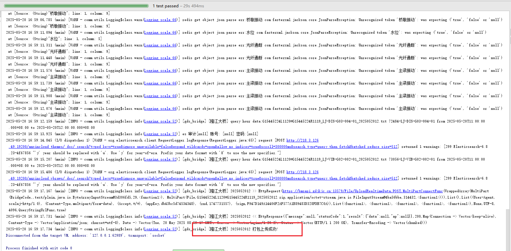
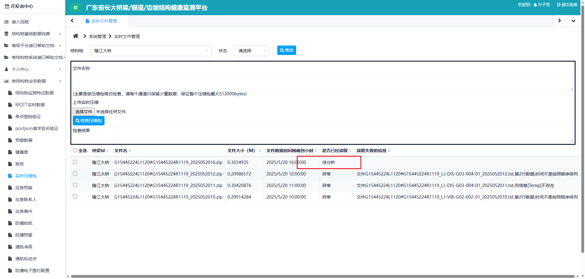

#### 安心云广东省平台上报功能说明

#### 一、功能描述

> 需求单：https://pms.anxinyun.cn/story-view-16070.html
>
> > **深汕项目桥梁、边坡实时数据上报**
> >
> > | id   | name         |
> > | :--- | :----------- |
> > | 5450 | 隆江大桥     |
> > | 5452 | 深汕东边坡   |
> > | 5455 | 螺河特大桥   |
> > | 5456 | 螺河东河大桥 |
>
> 上报文档：https://dev.gdjkjc.cn:50001/RealtimeDataFilePage

+ 实时粒度文件上传 （已完成）
+ 抽查特殊事件数据上传

代码路径：`FS-Anxinyun\trunk\codes\services\et\et_upload` (不需要更新MASTER)

配置上报：`consumers=gdsBridge,http_comm[广东省桥隧坡平台]`

需要配置：数据库、redis、ES连接


#### 二、功能自测






边坡配置：

```json
[
  {
    "name": "广东省桥隧坡平台",
    "category": "gds",
    "filter": {
      "structures": [
        "5452"
      ]
    },
    "http": {
      "url": "https://bmsapi.gdjkjc.cn:13579",
      "method": "POST",
      "headers": {
        "accept": "*/*",
        "Content-Type": "application/json"
      },
      "maps": {
        "structure:8471": {
          "structureCode": "project11223-",
          "AppKey": "cdf1493747174885",
          "AppSecret": "563e5d752181450da3b9d1617f75b527"
        }
      },
      "globals": {
        "deviceCode": "${label.code}"
      },
      "contents": [
        {
          "name": "北斗表面位移",
          "route": "/Api/V1/SlopeData/UploadBD",
          "filter": {
            "proto": "4003"
          },
          "body": "{\"code\":\"${deviceCode}\",\"structureCode\":\"${structureCode}\",\"dataTime\":\"${time}\",\"data\":[{\"x\":${data.x},\"y\":${data.y},\"h\":${data.z}}]}"
        },
        {
          "name": "深层水平位移",
          "filter": {
            "proto": "4005"
          },
          "route": "/Api/V1/SlopeData/UploadSBWY",
          "body": "{\"code\":\"${deviceCode}\",\"structureCode\":\"${structureCode}\",\"dataTime\":\"${time}\",\"data\":[{\"x\":${data.x},\"y\":${data.y},\"displacement\":${displacement},\"depth\":${depth}}]}"
        },
        {
          "name": "雨量",
          "filter": {
            "proto": "1003"
          },
          "route": "/Api/V1/SlopeData/UploadJYL",
          "body": "{\"code\":\"${deviceCode}\",\"structureCode\":\"${structureCode}\",\"dataTime\":\"${time}\",\"data\":[{\"hourData\":${data.rainfall},\"dayData\":0.0,\"cumulativeData\":0.0}]}"
        },
        {
          "name": "含水率",
          "filter": {
            "proto": "4015"
          },
          "route": "/Api/V1/SlopeData/UploadHSJC",
          "body": "{\"code\":\"${deviceCode}\",\"structureCode\":\"${structureCode}\",\"dataTime\":\"${time}\",\"data\":[{\"data\":${data.moiscont100}}]}"
        }
      ],
      "resp": {
        "statusCode": 1
      }
    }
  }
]
```


桥梁配置：

```json
{
  "url": "https://bmsapi.gdjkjc.cn:13579/File/UploadRealtimeData",
  "factors": {
    "5002": {
    },
    "1005": {
      "rt_datas": [
        {
          "item": "waterLevel",
          "field": "Data"
        }
      ]
    },
    "4007": {
      "rt_datas": [
        {
          "item": "x",
          "field": "X"
        },
        {
          "item": "y",
          "field": "Y"
        },
        {
          "item": "",
          "field": "Temp"
        }
      ]
    },
    "4002": {
      "rt_datas": [
        {
          "item": "x",
          "field": "Data"
        },
        {
          "item": "",
          "field": "Temp"
        }
      ]
    },
    "4008": {
      "rt_datas": [
        {
          "item": "crack",
          "field": "Data"
        },
        {
          "item": "",
          "field": "Temp"
        }
      ]
    },
    "3001": {
      "rt_datas": [
        {
          "item": "strain",
          "field": "Data"
        },
        {
          "item": "",
          "field": "Temp"
        }
      ]
    }
  },
  "bridges": [
    {
      "name": "隆江大桥",
      "struct": 5450,
      "address": "bms.gdjkjc.cn",
      "port": 8883,
      "username": "c05b1ac2",
      "password": "7885645bb858",
      "clientId": "",
      "bridgeCode": "G15445224L1120/G15445224R1119",
      "appKey": "db43bc5d74534348",
      "appSecret": "162c0a92f089464eaf9349358af4a830"
    },
    {
      "name": "螺河特大桥",
      "struct": 5455,
      "address": "bms.gdjkjc.cn",
      "port": 8883,
      "username": "2b957862",
      "password": "4633144c34de",
      "clientId": "",
      "bridgeCode": "G15441581L1320/G15441581R1321",
      "appKey": "11b8f81901134570",
      "appSecret": "1505ef9480e4491bb578e2d7d9781620"
    },
    {
      "name": "螺河东河大桥",
      "struct": 5456,
      "address": "bms.gdjkjc.cn",
      "port": 8883,
      "username": "3ec66288",
      "password": "23fa5c80c36f",
      "clientId": "",
      "bridgeCode": "G15441581L1310/G15441581R1311",
      "appKey": "d20477c3247b4012",
      "appSecret": "3d9bfb809be545bba11af17a88c81eb3"
    }
  ]
}
```


安心云标签配置

```sql
update t_sensor set labels='{code:FS-HGC01-V2.00}' where name='FS-HGC01-V2.00' and structure in (5456,5455,5450);
update t_sensor set labels='{code:LJ-DIS-G01-003-01}' where name='LJ-DIS-G01-003-01' and structure in (5456,5455,5450);
update t_sensor set labels='{code:LJ-DIS-G01-003-02}' where name='LJ-DIS-G01-003-02' and structure in (5456,5455,5450);
update t_sensor set labels='{code:LJ-DIS-G03-004-01}' where name='LJ-DIS-G03-004-01' and structure in (5456,5455,5450);
update t_sensor set labels='{code:LJ-DIS-G03-004-02}' where name='LJ-DIS-G03-004-02' and structure in (5456,5455,5450);
update t_sensor set labels='{code:LJ-DIS-P01-001-01}' where name='LJ-DIS-P01-001-01' and structure in (5456,5455,5450);
update t_sensor set labels='{code:LJ-DIS-P01-002-01}' where name='LJ-DIS-P01-002-01' and structure in (5456,5455,5450);
update t_sensor set labels='{code:LJ-DIS-P01-003-01}' where name='LJ-DIS-P01-003-01' and structure in (5456,5455,5450);
update t_sensor set labels='{code:LJ-DIS-P01-004-01}' where name='LJ-DIS-P01-004-01' and structure in (5456,5455,5450);
update t_sensor set labels='{code:LJ-DIS-P02-001-01}' where name='LJ-DIS-P02-001-01' and structure in (5456,5455,5450);
update t_sensor set labels='{code:LJ-VIB-G02-001-01}' where name='LJ-VIB-G02-001-01' and structure in (5456,5455,5450);
update t_sensor set labels='{code:LJ-VIB-G02-002-01}' where name='LJ-VIB-G02-002-01' and structure in (5456,5455,5450);
update t_sensor set labels='{code:LJ-VIB-P01-001-01}' where name='LJ-VIB-P01-001-01' and structure in (5456,5455,5450);
update t_sensor set labels='{code:LJ-VIB-P01-002-01}' where name='LJ-VIB-P01-002-01' and structure in (5456,5455,5450);
update t_sensor set labels='{code:LJ-VIB-P01-003-01}' where name='LJ-VIB-P01-003-01' and structure in (5456,5455,5450);
update t_sensor set labels='{code:LJ-VIB-P01-004-01}' where name='LJ-VIB-P01-004-01' and structure in (5456,5455,5450);
update t_sensor set labels='{code:LJ-VIB-P02-003-01}' where name='LJ-VIB-P02-003-01' and structure in (5456,5455,5450);
update t_sensor set labels='{code:LJ-VIB-P02-004-01}' where name='LJ-VIB-P02-004-01' and structure in (5456,5455,5450);
update t_sensor set labels='{code:LJ-WLV-P02-005-01}' where name='LJ-WLV-P02-005-01' and structure in (5456,5455,5450);
update t_sensor set labels='{code:LHD-VIB-G01-001-01}' where name='LHD-VIB-G01-001-01' and structure in (5456,5455,5450);
update t_sensor set labels='{code:LHD-VIB-G01-002-01}' where name='LHD-VIB-G01-002-01' and structure in (5456,5455,5450);
update t_sensor set labels='{code:LHD-VIB-G01-003-01}' where name='LHD-VIB-G01-003-01' and structure in (5456,5455,5450);
update t_sensor set labels='{code:LHD-VIB-G01-004-01}' where name='LHD-VIB-G01-004-01' and structure in (5456,5455,5450);
update t_sensor set labels='{code:LHD-VIB-P02-001-01}' where name='LHD-VIB-P02-001-01' and structure in (5456,5455,5450);
update t_sensor set labels='{code:LHD-VIB-P02-002-01}' where name='LHD-VIB-P02-002-01' and structure in (5456,5455,5450);
update t_sensor set labels='{code:LHD-VIB-P02-003-01}' where name='LHD-VIB-P02-003-01' and structure in (5456,5455,5450);
update t_sensor set labels='{code:LHD-VIB-P02-004-01}' where name='LHD-VIB-P02-004-01' and structure in (5456,5455,5450);
update t_sensor set labels='{code:LHT-CRK-G04-011-01}' where name='LHT-CRK-G04-011-01' and structure in (5456,5455,5450);
update t_sensor set labels='{code:LHT-CRK-G04-012-01}' where name='LHT-CRK-G04-012-01' and structure in (5456,5455,5450);
update t_sensor set labels='{code:LHT-DIS-G04-005-01}' where name='LHT-DIS-G04-005-01' and structure in (5456,5455,5450);
update t_sensor set labels='{code:LHT-DIS-G04-006-01}' where name='LHT-DIS-G04-006-01' and structure in (5456,5455,5450);
update t_sensor set labels='{code:LHT-RSG-G03-002-01}' where name='LHT-RSG-G03-002-01' and structure in (5456,5455,5450);
update t_sensor set labels='{code:LHT-RSG-G03-004-01}' where name='LHT-RSG-G03-004-01' and structure in (5456,5455,5450);
update t_sensor set labels='{code:LHT-RSG-G03-007-01}' where name='LHT-RSG-G03-007-01' and structure in (5456,5455,5450);
update t_sensor set labels='{code:LHT-RSG-G03-009-01}' where name='LHT-RSG-G03-009-01' and structure in (5456,5455,5450);
update t_sensor set labels='{code:LHT-RSG-G04-002-01}' where name='LHT-RSG-G04-002-01' and structure in (5456,5455,5450);
update t_sensor set labels='{code:LHT-RSG-G04-004-01}' where name='LHT-RSG-G04-004-01' and structure in (5456,5455,5450);
update t_sensor set labels='{code:LHT-RSG-G04-007-01}' where name='LHT-RSG-G04-007-01' and structure in (5456,5455,5450);
update t_sensor set labels='{code:LHT-RSG-G04-009-01}' where name='LHT-RSG-G04-009-01' and structure in (5456,5455,5450);
update t_sensor set labels='{code:LHT-RSG-G05-002-01}' where name='LHT-RSG-G05-002-01' and structure in (5456,5455,5450);
update t_sensor set labels='{code:LHT-RSG-G05-004-01}' where name='LHT-RSG-G05-004-01' and structure in (5456,5455,5450);
update t_sensor set labels='{code:LHT-RSG-G05-007-01}' where name='LHT-RSG-G05-007-01' and structure in (5456,5455,5450);
update t_sensor set labels='{code:LHT-RSG-G05-009-01}' where name='LHT-RSG-G05-009-01' and structure in (5456,5455,5450);
update t_sensor set labels='{code:LHT-VIB-G01-001-01}' where name='LHT-VIB-G01-001-01' and structure in (5456,5455,5450);
update t_sensor set labels='{code:LHT-VIB-G01-002-01}' where name='LHT-VIB-G01-002-01' and structure in (5456,5455,5450);
update t_sensor set labels='{code:LHT-VIB-G01-003-01}' where name='LHT-VIB-G01-003-01' and structure in (5456,5455,5450);
update t_sensor set labels='{code:LHT-VIB-G02-001-01}' where name='LHT-VIB-G02-001-01' and structure in (5456,5455,5450);
update t_sensor set labels='{code:LHT-VIB-G02-002-01}' where name='LHT-VIB-G02-002-01' and structure in (5456,5455,5450);
update t_sensor set labels='{code:LHT-VIB-G02-003-01}' where name='LHT-VIB-G02-003-01' and structure in (5456,5455,5450);
update t_sensor set labels='{code:LHT-VIB-P01-001-01}' where name='LHT-VIB-P01-001-01' and structure in (5456,5455,5450);
update t_sensor set labels='{code:LHT-VIB-P01-002-01}' where name='LHT-VIB-P01-002-01' and structure in (5456,5455,5450);

```

