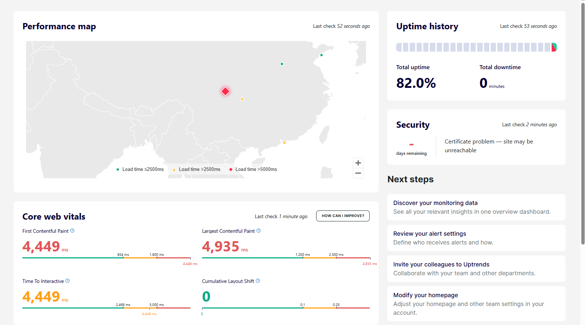
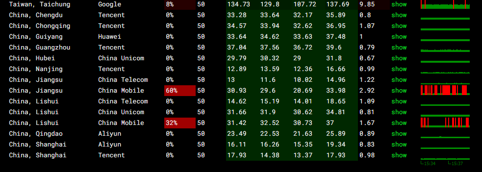
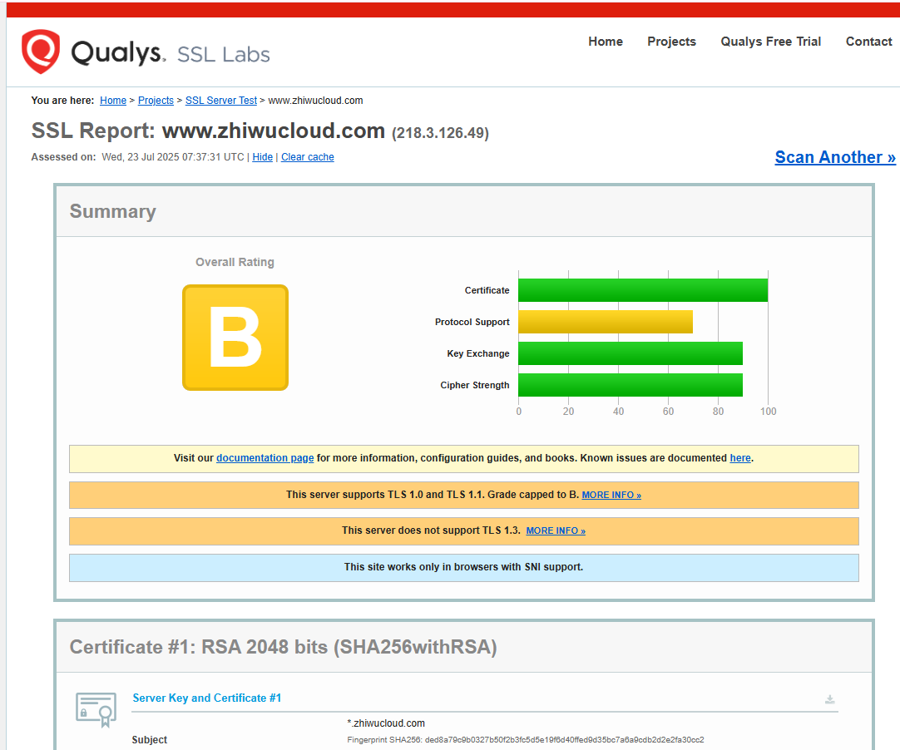

针对部分网站访问速度慢，进行服务访问速度的排查工作：

### 服务器流量排查

监控系统流量

```sh
#!/bin/bash
while true; do
  RX1=$(cat /sys/class/net/eno1/statistics/rx_bytes)
  TX1=$(cat /sys/class/net/eno1/statistics/tx_bytes)
  sleep 1
  RX2=$(cat /sys/class/net/eno1/statistics/rx_bytes)
  TX2=$(cat /sys/class/net/eno1/statistics/tx_bytes)

  RX_RATE=$(( (RX2 - RX1) / 1024 ))
  TX_RATE=$(( (TX2 - TX1) / 1024 ))
  echo "RX: ${RX_RATE} KB/s, TX: ${TX_RATE} KB/s"
done

```


### 用Uptrends监控网站外部访问情况

https://app.uptrends.com/ValueHub





zhiwucloud-Browers check

https://app.uptrends.com/Report/ProbeDashboardFpc?probeGuids=41fc9761-3e59-45c1-9170-40cbf6128f44


zhiwucloud -Uptime

https://app.uptrends.com/Report/ProbeDashboardGeneric?probeGuids=0447bf48-65f2-45b1-801d-7d33b2e1735c#


| 字段名               | 含义                                        |
| -------------------- | ------------------------------------------- |
| **Monitor**          | 检查类型（如 Uptime、SSL 证书、浏览器检查） |
| **Uptime (%)**       | 可用率：在检测周期内网站正常工作的百分比    |
| **Checks**           | 执行了多少次检查                            |
| **Confirmed errors** | 检测到并确认的问题次数（不是暂时性错误）    |

检查域名能不能正常Ping通(是否网络可达)

https://ping.pe/zhiwucloud.com



SSL检查：https://www.ssllabs.com/ssltest/analyze.html?d=www.zhiwucloud.com

