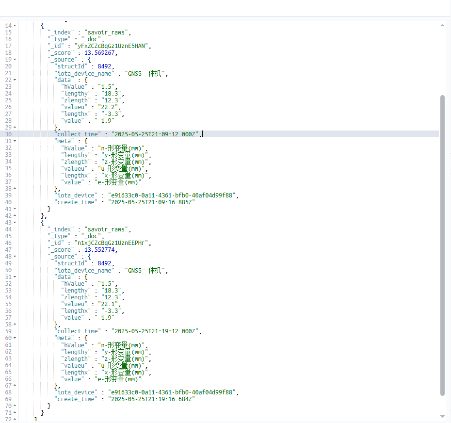

知物云数据丢失

> 知物云https://console.zhiwucloud.com/njgeot83421939/signin下的结构物“巴岳山边坡监测”的GNSS采集粒度10分钟，实际数据出现丢失情况。

在`iOTA`集群中kafka中查看数据：

在安心云平台查看数据：

问问ChatGPT:

>  用kafka bin工具调用查看数据，./kafka-console-consumer.sh --bootstrap-server iota-m2:6667 -topic RawData --from-beginning | grep 'e91633c0-0a11-4361-bfb0-40af04d99f88'  | grep '2025-05-26T05'
> 发现数据丢失了2条。 我们的进程也是订阅这个topic，只有这丢失的两条，这会是什么原因，kafka会分裂成多个集群吗？

不太可能！

重启以太规则引擎看看。