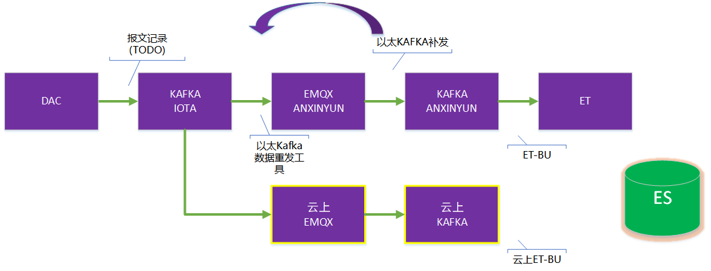

## 补数据方法说明和优化方案

### 现有补数据方法

#### 场景1. 安心云有设备数据

📌 出现原因：

1. 计算公式、绑定配置错误或者需要调整计算参数
2. 异常：其他异常导致测点（主题）数据保存失败

🛠 补数据方法：执行重计算

#### 场景2. ET问题导致丢数据，安心云Kafka有数据

📌出现原因：

1. ET程序故障导致数据处理丢失

🛠 补数据方法：执行补录ET程序

#### 场景3. 数据传输导致丢数据，以太Kafka有数据

📌出现原因：

1. EMQX问题
2. 规则引擎传输问题
3. 安心云receiver问题
4. 安心云Kafka环境问题

🛠 补数据方法：

1. 云上执行ET-BU
2. 以太集群上用data-mover工具将数据重发到`mqtt`

#### 场景4. DAC问题导致，只有报文日志

📌出现原因：

1. 以太环境问题（Kafka问题）
2. DAC问题

🛠 补数据方法：

1. 目前暂无办法


数据流程图以及各环节补数据工具说明：




从以太kafka导出数据的命令：(在anxin-m1服务器上执行)

```sh
 # 安心云 指定时间和关键字（一般取ThingID或者UserID(如果需要补所有数据)）
 java -cp data-mover-1.0-SNAPSHOT-allinone.jar \
 Beautiful.t \
kafka.brokers=iota-n1:6667,iota-n2:6667,iota-n3:6667,iota-n4:6667 \
kafka.topic=RawData \
 "start=earliest" \
 "filter.start=2025-08-03 07:55:00" \
 "filter.end=2025-08-03 08:20:00" \
 cmd=kafka-console-consumer-ex \
 keyword=ec6852f7-1c75-45d7-9dc1-4f5ef632933e \
 mqtt.topic=anxinyun_data \
 mqtt.broker=tcp://anxin-m1:6883
 

# 因为以太KAFKA只保存两天的数据，所以有时需要将对应时间范围的数据先保存到本地：
# 保存所有数据到本地文件 （也可以是用keyword参数过滤，保存指定内容的数据）
  java -cp data-mover-1.0-SNAPSHOT-allinone.jar \
 Beautiful.t \
kafka.brokers=iota-n1:6667,iota-n2:6667,iota-n3:6667,iota-n4:6667 \
kafka.topic=RawData \
 "start=earliest" \
 "filter.start=2025-06-09 23:00:00" \
 "filter.end=2025-06-10 08:40:00" \
 cmd=kafka-console-consumer-ex \
 save.to.disk=/home/anxin/kafka250610.log
 
 
 # 从本地文件读取，将数据推送到安心云/知物云平台MQTT重新处理数据
 java -cp data-mover-1.0-SNAPSHOT-allinone.jar \
 Beautiful.t \
 "filter.start=2025-06-09 23:00:00" \
 "filter.end=2025-06-10 08:40:00" \
 cmd=from-file \
 debug=true \
 keyword=511fc63c-6232-4b46-9b15-91ed3b236059 \
 mqtt.topic=savoir_data2 \
 save.to.disk=/home/anxin/kafka250610.log \
 mqtt.broker=tcp://117.89.29.15:34455
```


通过ET-BU执行补数据，一般在k8s中部署et-main程序，执行参数中指定模式`bu`,如下“：

```yaml
 args:
            - group.id = et_bulu
            - work.mode=bu
            - kafka.topics.data=anxinyun_data
            - kafka.topics.upload=anxinyun_upload
            - kafka.topics.alarmMsg=anxinyun_alarmMsg
            - kafka.topics.aggregation=anxinyun_agg
            - 'kafka.special.time.start=2025-08-01T13:00:00+08:00'
            - 'kafka.special.time.end=2025-08-01T17:45:00+08:00'
            - es.themes.index.name=anxincloud_themes
            - es.raws.index.name=anxincloud_raws
            - es.vbraws.index.name=anxincloud_vbraws
```

其中，可以增加过滤器，比如先处理指定`ThingID`的结构物，则可以增加如下参数：

```yaml
            - filter.regex = c25d70dc-cd09-4247-8e60-2093a3219c0b  # 对应结构物的ThingID
```

注意：补录程序完成补录后不会退出，会继续消费Kafka消息，但不会进行数据处理和存储。建议关闭，以免额外的资源消耗。

注意：补录程序可以多实例运行。

### 优化方案

> 目前补录的方法，均是从Kafka捞取数据重新消费。

#### 性能优化

以太Kafka因为版本太老，不支持从`TimeStamp`时间定位到具体偏移量，故必须设定为 `start=earliest`, 从Kafka最早数据进行处理。

这导致从以太Kafka恢复数据，效率一般较慢，

本次**优化内容**只有一个：

1. 以太集群Kafka升级（加入新服务器到集群，并部署新版本的Kafka）

#### 报文补数据

**新需求**内容：如果DAC问题或者环境问题，导致以太Kafka数据丢失。 需要考虑从报文日志记录恢复数据。

这种补数据的方法有一些局限性，并且不能当前设备采集链路。所以，建议做成工具，每次处理单个设备的补数据请求。

**HTTP接口设计说明（用于单设备补数据）**

接口路径：

```
POST /restore-data
```

请求参数（JSON格式）：

```json
{
  "thingId": "设备唯一标识符",
  "startTime": "补数据起始时间（ISO8601格式，例如：2025-08-01T00:00:00+08:00）",
  "endTime": "补数据结束时间（ISO8601格式，例如：2025-08-01T12:00:00+08:00）"
}
```

说明：

- `thingId`：指定需要补数据的设备
- `startTime` / `endTime`：用于限制从日志中提取数据的时间窗口

接口行为：

1. 接收到请求后，启动一个专用于补数据的处理流程。

2. 使用 `thingId` 启动独立 DAC 实例（Single 模式，仅启动监听维度）。

3. 从 iota 报文日志中查询对应设备在时间范围内的上传数据。

4. 日志格式示例（通过连接KEY识别）：

   ```
   [D] [soip:40001:25026031] <- fe000b03e8018a000000000f015a010005003f91eb85000000005a28bbef
   ```

5. 解析报文内容并加入待处理队列。

6. 创建一个虚拟连接，模拟设备向 DAC 上报数据。

7. 通过虚拟连接将队列中的报文逐一发往 DAC。

8. DAC 正常处理报文并通过原有的 Kafka 链路发送数据。

9. 补数据任务完成后自动释放 DAC 资源。

------

**设计原则与限制说明**

- 该补数据服务**不影响当前采集链路**，为完全独立流程。
- 仅用于**手动触发的单设备补数据操作**，不适合批量处理。
- 仅支持处理**监听类数据（非指令/应答）**。
- Kafka 丢包时建议第一时间分析日志是否可用作为补偿依据。
- 可与平台管理端结合，提供补数据操作界面。