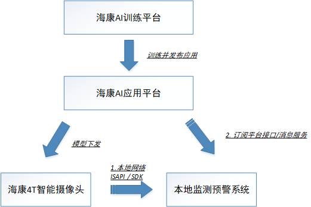
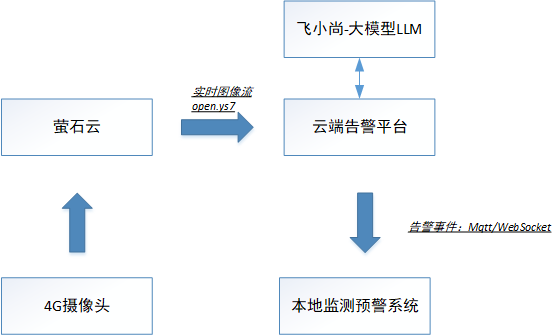

## 边坡滑坡预警AI识别功能

####  方案一：海康摄像头 + 海康威视AI开放平台

使用海康的智能摄像头(4T 4G)配合其AI开放平台（包括实时处理平台 + 算法应用平台），完成滑坡识别模型的训练、部署和前端告警。

包括：

- 海康智能摄像头（具备AI算力）
- 海康威视AI开放平台（`iVMS`、AI开放平台）包括实时训练和算法应用平台。
- 自研或第三方滑坡识别算法（在平台上训练）
- 局域网或公网接入（供事件消息下发）

> 如果现场工控机有网络可以连到摄像头，可以直接调`SDK`①。 否则需要订阅海康平台事件通知②。

#### 方案二：标准摄像头 + 萤石云 + 云端大模型识别

使用普通4G摄像头，通过萤石云平台将实时图片流上传至云端，由大模型进行识别和预警。

包括：

- 普通RTSP摄像头（无需边缘AI能力）
- 萤石云视频接入平台（RTSP推流 + 云存储）
- 云端AI识别服务（大模型推理、滑坡检测）
- 云端告警平台（告警推送、可视化）

------

#### 📊 总体对比

| 维度       | 海康智能+AI平台       | 标准摄像头+萤石云+大模型        |
| ---------- | --------------------- | ------------------------------- |
| 实时性     | **高**，本地识别      | 中，需上传识别                  |
| AI推理位置 | 边缘（摄像头内）      | 云端大模型                      |
| 成本       | 高（摄像头+平台费用） | **低**（普通摄像头+云流量费用） |
| 部署难度   | 中（需熟悉海康平台）  | 低（标准RTSP接入）              |
| 可扩展性   | 中，平台封闭          | 高，可集成多种云服务            |
| 告警能力   | 本地+中心告警支持     | 云端告警平台                    |